# About this fork

[paulm981/Submarine](https://github.com/paulm981/Submarine) is a fork of [Submarine](https://github.com/SinaXhpm/submarine) by Sina. It aims to be the SSH client and session manager a team needs for a large, shared set of servers, on Windows, macOS and Linux alike, while staying as close to the original project as it can.

This page covers:

- [What this fork adds](#what-this-fork-adds), with pictures
- [Where it behaves differently](#where-it-behaves-differently) from the original
- [Changes in the original project not taken yet](#changes-in-the-original-project-not-taken-yet), and why
- [How it keeps up with the original project](#keeping-up-with-the-original-project), and how releases are numbered

What changed in each release is in [CHANGELOG.md](CHANGELOG.md).

The fork is based on the original project's **0.4.0**, with every change up to [#297](https://github.com/SinaXhpm/submarine/pull/297) brought in.

## What this fork adds

**Settings in categories.** Settings has tabs across the top: General, Terminal, Servers & sessions, AI tools, Sync and Help. It opens on the one you used last. Each setting says what it does in one line, with the longer explanation behind **Learn more**. **Settings › Terminal** below means that tab ([#168](https://github.com/paulm981/Submarine/issues/168)).

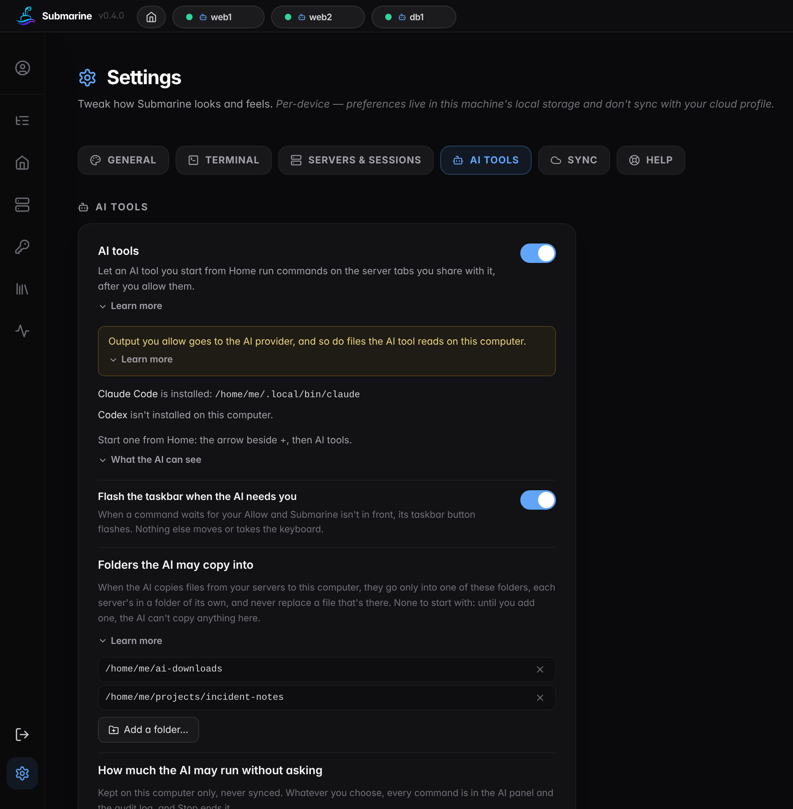

### Work on many servers at once

**Broadcast is one screen for many servers** ([#218](https://github.com/paulm981/Submarine/issues/218)): tick servers in the Broadcast menu (the round icon at the top right), or **All**, and their terminals open side by side on the Wall; what you type in any of them goes to all of them. Ticking is turning it on: there's no separate switch to remember, and unticking them all (**None**) ends it and takes you back where you were. Ticking or unticking a server adds or takes off its tile; terminals you pinned to the Wall by hand stay. A tile shows what the server prints from the moment it's on the Wall, so press Enter to see a prompt. **Type to one**: the target button on a tile's header types to that server alone, and the bar says so (**Typing to db1 only**); clicking into another tile types to that one instead, and **Type to all** goes back. **Pause** one with the pause button on its header, or Ctrl+Shift+P in it: it says **Paused** and gets nothing typed elsewhere, while what you type into it goes to it alone. Ctrl-click (⌘ on a Mac) or Shift-click pause buttons to pick several, then **Pause** or **Resume** them on the bar; **Pause all** and **Resume all** are there too, and the bar counts who's typed to (**Typing to 2 of 3 · 1 paused**). When Broadcast ends, all of that is forgotten. It's the original project's Broadcast and Wall, with small hooks that tick, pin and pause through them. The fork's old Walls are gone (saved walls and Send to all are coming back the same way), so this stays easy to sync. Walls saved by an older version stay in the profile, unused ([#162](https://github.com/paulm981/Submarine/issues/162)). One line differs: what you type goes to every target in one call to the app's backend, not one call per server, so typing to 36 servers keeps up ([#127](https://github.com/paulm981/Submarine/issues/127)). A server that falls behind (a big paste on a slow link) gets its keys on its own, in order, until it catches up, so it never holds up the others; and a paste of any size reaches every server ([#205](https://github.com/paulm981/Submarine/issues/205)).

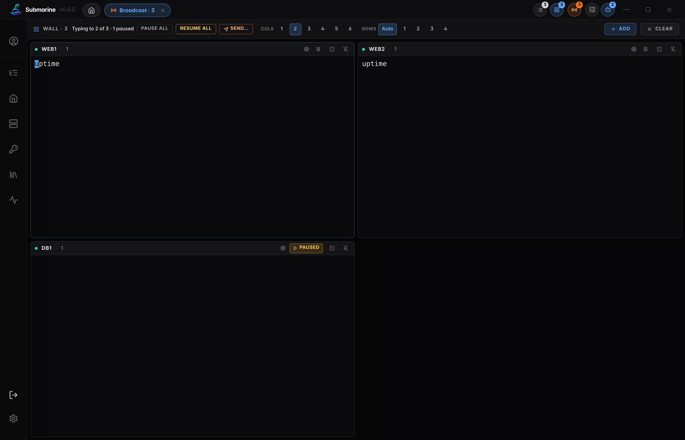

- **Jump hosts at scale.** A hundred servers behind one jump host log in a few at a time, in terminals and in Monitoring; the number is a setting. Monitoring reaches servers through their jump host too, by the same `~/.ssh/config` name as the terminal.
- **Split.** A second shell on the same server opens beside the first, so you can watch a log in one and work in the other.
- **Push and pull files on many servers.** Right-click a tab, or servers in the session tree, and pick **Push files to servers…** or **Pull files from servers…**. Tick the servers; with Broadcast on, its targets come ticked. A push sends files (pick several at once) or a whole folder from this computer into the same folder on each server. A pull fetches a file or folder from each server into a folder of its own here, named after the server. Before anything moves, a summary says how much goes where and what's already there: skip those (the default) or replace them, once for the whole run. Four servers copy at a time, each with its own row; one that fails doesn't stop the others, and **Stop** stops them all. It uses the SFTP pane's own transfers and their checks ([#159](https://github.com/paulm981/Submarine/issues/159)).
- **Many tabs.** **Ctrl+Shift+K** opens All tabs with its search ready: type part of a name and press Enter. **Ctrl+Tab** and **Ctrl+Shift+Tab** move between tabs. A tab's right-click menu closes the other tabs, the ones to its right, the disconnected ones, or all of them.

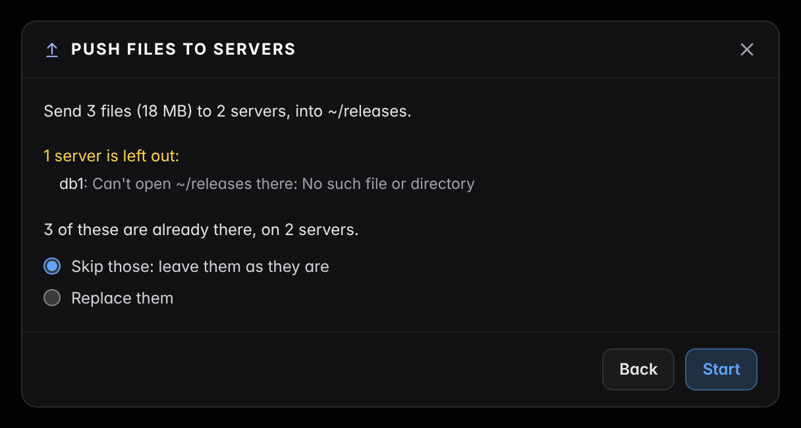

### Organize them

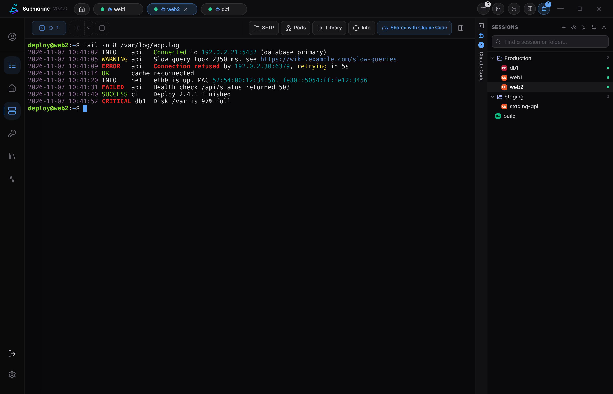

- **A session tree** beside the terminal, with search. It holds folders and servers (SSH, Remote Desktop, VNC and telnet), and you manage it with drag and drop, rename, move and delete. **Show only open** (the eye button) narrows it to the servers you have open.
- **OS badges** on servers, and a badge for each server that isn't SSH.
- **Ping** a server from its right-click menu in the tree or the grid, while it reboots, say. A small panel shows each answer and its time, when the server stopped answering and came back, and whether its SSH port answers yet. A quiet sound plays when you can log in again. It's a plain connection to the port, so it works where ping is blocked; behind a jump host it checks from the jump host, over a connection you already have open.

### Bring your sessions with you

**Session import that keeps your setup.** The MobaXterm import keeps everything below as it was:

- nested folders;
- saved logins;
- jump hosts and their keys;
- startup commands such as `dzdo su -`;
- Remote Desktop sessions.

A result screen says what came in. PuTTY and OpenSSH config imports are there too.

### Jump hosts and your SSH config

With **Use settings from ~/.ssh/config** on (**Settings › Terminal**, under Authentication), servers connect the way `ssh` would:

- **ProxyJump.** A server behind a chain of jump hosts connects, as with `ssh -J`. Each jump host waits its turn to log in (**Logins at a time per jump host**, in **Settings › Servers & sessions**), so a hundred servers don't all log in to it at once. A server's own saved jump host or proxy still comes first.
- **Key files and certificates.** The IdentityFile keys the config names are tried, each with its certificate (CertificateFile, or `<key>-cert.pub`), so Teleport nodes connect. An expired certificate is skipped, and the log says so.
- **known_hosts.** A host key listed there skips the first-time question, and is saved to Submarine's own trusted keys. Those always come first: a key that changed gets the warning, even when known_hosts lists the new one. A key marked `@revoked` is always refused.
- **Host certificates.** A server's certificate is trusted through an `@cert-authority` line in known_hosts, checked as OpenSSH checks it. If the key in it isn't the one Submarine trusts for the server, as after a server is reinstalled, you get the changed-key warning and decide. A certificate that doesn't check out is refused.

Nothing is written to `~/.ssh`. With the setting off, none of these files is read.

**Jump via** in a server's form is a search box: type part of a name, address or folder, then pick with the arrow keys and Enter. Servers already used as a jump host come first.

The details, and where this differs from the original project, are in the [table below](#where-it-behaves-differently).

### AI help, without sharing keys

A first test, off by default. To try it, install Claude Code or Codex, turn on **Settings › AI tools**, then start it from Home's menu (the arrow beside **+**, then **AI tools**).

<table>
  <tr>
    <td width="50%" valign="top" align="center">
      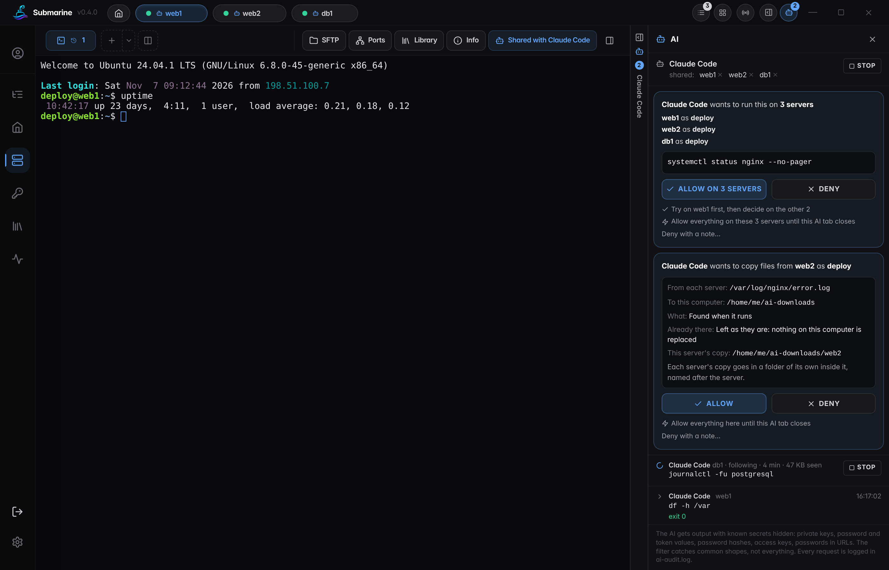
      <br/><sub><b>The AI panel</b>: one card for a command on three servers, a copy, and a log being followed</sub>
    </td>
    <td width="50%" valign="top" align="center">
      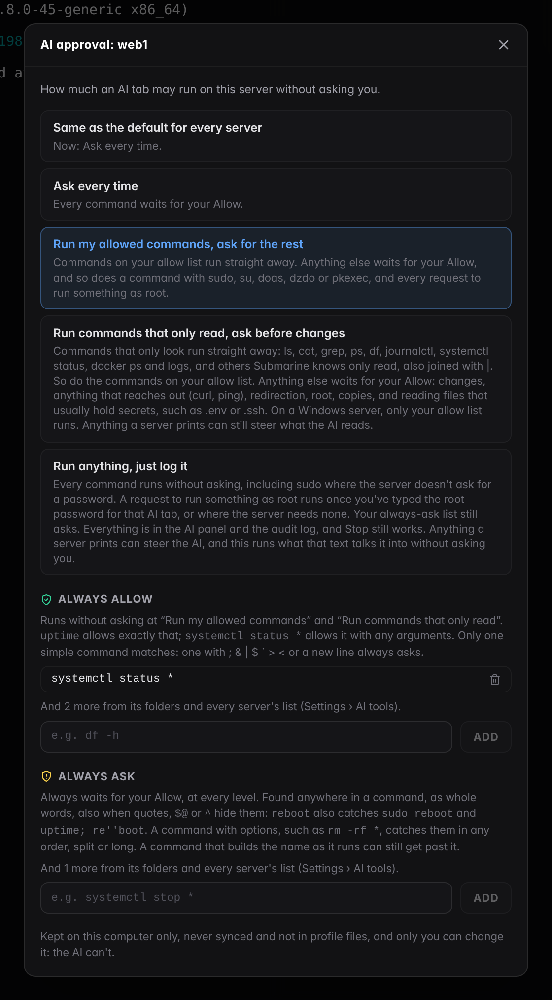
      <br/><sub><b>How much the AI may run without asking</b>, per server, folder or every server</sub>
    </td>
  </tr>
</table>

- **Claude Code or Codex from Home's menu** opens already connected to Submarine through a local channel only your account can use. Nothing listens on the network. Each AI tool is an entry in a list, given Submarine's MCP server the way that tool takes one, so adding another is little code ([#117](https://github.com/paulm981/Submarine/issues/117)).
- **Share with AI** on a server's tab lets that AI tab ask to run commands there. Unless you've said otherwise (below), each one waits in the **AI panel** (the title bar's AI button) until you click Allow or Deny; typing can't approve anything. Its card says which server it runs on and as whom ("on **web-01** as **root**"). A tab logged in as root, or a command with sudo, dzdo, su, doas or pkexec, is marked as root. Where those need no password, nothing asks first, and Submarine can't always tell. **Deny with a note** tells the AI why, so it can try another way. When a command waits for you and Submarine isn't in front, its taskbar button flashes (you can turn that off).
- **How much it may run without asking is up to you, per server.** **Ask every time** is the default. **Run my allowed commands, ask for the rest** runs the commands on your allow list straight away. **Run commands that only read, ask before changes** also runs commands Submarine knows only look (below). **Run anything, just log it** runs every command, sudo included where the server doesn't ask for a password. Set it on a server or a folder from the session tree's right-click menu (**AI approval…**), or for every server in **Settings › AI tools**; a server's own setting wins over its folder's, and a folder's over the default.
  - **Allow rules** match one whole, simple command: `uptime` exactly, `systemctl status *` with any arguments, `cat /var/log/*` with the rest of that one word (no second file, no `..`). A command with `;`, `&&`, `|`, `$(`, a backtick, a redirect, a new line, a hidden or full-width character never matches, nor `%` or `^` on a Windows server. sudo, su, doas, dzdo, pkexec, sudoedit, run0, runuser and `machinectl shell` always ask unless the server runs anything, however they're written. **Always allow this command here** on a card adds one; a pattern for a command that runs other commands (`timeout *`, `bash *`, `find *`) says so by name and takes one more click.
  - **The always-ask list** beats every allow rule and **Run anything**. It finds its words anywhere in a command, read twice: plainly, and with what can hide a word taken out (quotes, `$@`, `${…}`, empty `$()`, brace groups, cmd.exe's `^` and `%…%`, PowerShell's backticks, a path or `.exe`, and globs where a program's name goes, so `/sbin/reb?ot` asks but `ls *.txt` doesn't). `rm -rf *` catches its options in any order, split or long. A command that builds the name as it runs can still get past it. It starts with `reboot`, `shutdown`, `rm -rf *`, `dd *`, `format`, `Restart-Computer` and a few more.
  - **Commands that only read** ([#190](https://github.com/paulm981/Submarine/issues/190)) are decided by Submarine, from a list, never by the AI. Anything not on the list asks.
    - **What runs:** one program on the list, or several joined with `|`, in plain words and quotes. Programs like `ls`, `cat`, `grep`, `ps`, `df`, `du` and `ss`, and some only with words that show: `systemctl status`, `journalctl` without `--vacuum`, `docker ps` and `logs`, `find` without `-delete` or `-exec`, `ip … show`, `dpkg -l`, `rpm -q`. A shortened long option (`--vac`) counts as the whole one.
    - **What asks:** redirection, `;`, `&&`, `$`, backticks, `NAME=value` first, a program named by its path, and a glob that could turn into an option (`*.log` asks, `/var/log/*.log` runs). Programs that can run code or write while they look as if they read are left off: `sed`, `awk`, `git`, `less`, `jq`, `env`, `xargs`, `tee`. So is anything that reaches out: `curl`, `wget`, `ssh`, `ping`, `dig`.
    - **Also asks:** root, every copy (a folder pulled could hold keys), `/proc/…/root` and other ways back to a device, and every command on a Windows server or one whose OS Submarine doesn't know (detection off or not run yet, a quick connect, a server it couldn't read), where only your allow list runs: cmd and PowerShell read the same words otherwise ([#206](https://github.com/paulm981/Submarine/issues/206)).
    - **Files that usually hold secrets ask:** a command naming `.env`, `.ssh`, `.aws`, `.netrc`, `shadow`, a private key and the like, and a glob that could expand to one (`/etc/shado?`, `.e*`, `/etc/ssl/private/*`; `/var/log/*.log` runs). It's a best effort, not a wall: a secret in a file with another name, or found by `grep -r`, is still read. Text a server prints can still steer what the AI reads.
    - **Stored as 4.** An older Submarine reads it as **Ask every time**.
  - **Allow everything here until this AI tab closes**, on a card, runs the rest on that server for that AI tab, but for the always-ask list, until the AI tab closes, the server stops being shared or its tab reconnects, AI tools are turned off, the profile is locked, you end it (the AI pane and panel have a button), or you set a level that reaches the server.
  - **You can always see it.** A shared server's tab and the AI pane say "allowed commands run", "read-only commands run" or "runs without asking", with a click to change it; commands that ran without asking are marked so in the AI panel; the audit log records how each was allowed. At most four commands from one AI tab run at once on a server.
  - **Levels and rules stay on this computer.** They never sync, so a shared profile can't change them, and the AI can't either. They don't travel in a profile file: opened by another install, a vault keeps only its always-ask list.
  - **A teammate's change is held.** A server someone else moves (or moves a folder above), or adds, somewhere the AI may do more here, or a server the AI may run commands on that someone points at another host, port, user, jump host or proxy, waits in **Waiting for your OK**; until then every command on it asks. **Keep as it was** keeps it at **Ask every time** here.
- **Root when the AI needs it.** The AI asks Submarine to run a command as root, instead of typing sudo itself. Submarine runs it through the server's sudo or dzdo, the same way SFTP root mode does, `dzdo su -` and csh or tcsh logins included. The card says "on **web-01** as **root** (via sudo)".
  - **The password is typed in Submarine.** Where the server wants one, the card asks you for it. It goes only to sudo's or dzdo's own prompt, as in [Root when you need it](#root-when-you-need-it): one try each time you type it, and a wrong one brings the card back. The AI only hears that it was refused, or denied. It's only as safe as the server account, so a sudoers rule that needs no password for the commands you want is safer.
  - **It's kept for that AI tab and server only,** until access ends (below), AI tools are turned off or the profile locks. It's never shared with the tab's own SFTP root mode or Info panel, either way, so the AI never inherits root you already have. It's never in the output, the audit log, the app log or anything the AI gets.
  - **Levels:** at **Ask every time**, **Run my allowed commands** and **Run commands that only read**, every root request asks, whatever your allow rules say. At **Run anything**, it runs without asking once you've typed the password for that AI tab, or where the server needs none. The always-ask list still asks.
  - **It never rides on your sudo.** sudo remembers a sign-in for a while (a "ticket"), usually for one terminal only, but on servers set to share it across terminals (`timestamp_type=global`) a sudo you just typed in your own terminal would otherwise count for the AI too. The AI's root never uses a ticket, and its own check of the password leaves none behind, so each root command signs in on its own.
  - **One command, no terminal,** like every other command: it can't open a root shell (`sudo -i`, `su -`) or start with an option for sudo. Stop ends its channel at once, but the command itself runs as root under sudo, which a signal from your login can't reach: on the server it ends when it next writes, or when it finishes. The audit log marks it `as_root`, with the tool.
- **The AI asks for a server by name** ([#196](https://github.com/paulm981/Submarine/issues/196)). When the one it needs isn't shared, it asks for it by name, and a card in the AI panel and the AI side pane asks you: **Share** opens the server's tab if it isn't open and shares it once it's connected, under its own approval level; the card says it's connecting meanwhile, and **Don't share** or **Stop** before then means it isn't shared. **Don't share** says no. Only an exact name, ignoring case in any alphabet, finds a saved SSH server (not an RDP, VNC or telnet one), and the AI never gets a list of them. A name no server has gets a card too (**Dismiss**), and the AI hears the same words as when you say no, so it can't learn which names you have, and its asking shows up on your screen. One such request waits at a time for each AI tab, and it counts with its other waiting requests ([#210](https://github.com/paulm981/Submarine/issues/210)).

  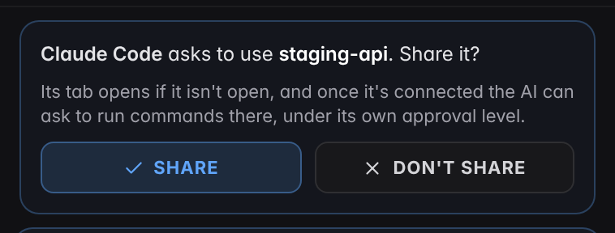

- **One request on many servers.** For the same command on several shared servers, the AI asks once, on one card that lists every server: **Allow on 12 servers**, **Deny**, **Try on web1 first, then decide on the other 11** (it runs on the first server only, its result shows in the AI panel, and the rest keep waiting; [#193](https://github.com/paulm981/Submarine/issues/193)), or **Allow everything on these servers until this AI tab closes**. It runs without asking only where every server's settings would run it; the always-ask list still holds ([#158](https://github.com/paulm981/Submarine/issues/158)).
- **Copying files to and from many servers.** The AI can push a file or folder from this computer to shared servers, or pull one from each, as one request on one card: the direction, the paths, the servers, how many files and how big, and whether files already there are replaced. It copies without asking only where every server is at **Run anything**. A pull goes only into a folder you added under **Settings › AI tools › Folders the AI may copy into** (none at first), each server's copy in a folder of its own, and never replaces a file here; a push never follows a link on this computer. At most 1,000 files and 2 GB to or from each server, four servers at a time, all in the audit log. It uses the app's own transfers, as the user's do, and never the root a tab's file panel has on ([#159](https://github.com/paulm981/Submarine/issues/159)).
- **The newest MCP, and the older ones.** Submarine's MCP server speaks MCP 2026-07-28, the protocol's newest version, as well as the versions before it, back to 2024-11-05 ([#177](https://github.com/paulm981/Submarine/issues/177)).
- **One question per command.** Claude Code and Codex start with Submarine's tools allowed, so only Submarine asks before a server command. They still ask before what they do on your computer, as you've set them to.
- **The AI side pane** shows an AI tab beside a server tab shared with it: the same terminal as in Home, open or folded to a bar (**Ctrl+Shift+L**), with Share, Unshare, Allow and Deny in its header. The keyboard goes into it only when you click in its terminal; opening or folding it leaves the keyboard where it was. The terminal with the keyboard is bright, and the other dims. A server tab's **+** menu (right-click the **+**) has **Claude Code beside this** (or Codex), which starts one, shares the tab with it and shows it there.
- **Commands run on Submarine's own connection**, so the AI never gets a key or password. Each one runs without a terminal, with a time limit and at most 1 MB of output. You see all of it; the AI gets it with known secrets hidden, and you see how many.
- **Following a log.** The AI can ask to follow a command such as `journalctl -u nginx -f`: one card, marked as a follow, and then it reads what's new every few seconds. Submarine keeps the newest 256 KB between reads and tells the AI when older output was dropped. A follow runs as the tab's login, not as root, and shows in the AI panel with **Stop**. It also stops after 30 minutes without a read, after 2 hours, or when access ends. At most four per AI tab ([#179](https://github.com/paulm981/Submarine/issues/179)).
- **What a server prints is marked as the server's words.** The AI gets it between two tags with a random id the server can't guess, and a line saying it's data, not instructions; the exit code and Submarine's other lines stay outside. It's a strong hint to the AI, not a wall: at **Run anything**, text on a server can still talk it into a command ([#178](https://github.com/paulm981/Submarine/issues/178)).
- **The AI knows the ground rules up front.** Asked what's shared with it, it hears each server's name, its OS where Submarine has detected one (the one its badge shows, so the AI writes commands for that system; [#193](https://github.com/paulm981/Submarine/issues/193)), and what happens there ("asks the user each time", "runs the user's allowed commands, asks for the rest", "runs commands that only read and the user's allowed commands, asks for the rest" or "runs anything"), the folders it may copy into, and the limits. It never hears your rules ([#176](https://github.com/paulm981/Submarine/issues/176)).
- **Every request and decision goes in `ai-audit.log`** in the log folder. A command you allow is logged at once, and again when it ends.
- **One program per AI tab.** A second program that tries to connect as the same AI tab is refused, and the AI panel warns you.
- **Access ends** when you unshare, close the AI tab or the server's tab, the server's tab reconnects, or Submarine quits. Anything waiting is cancelled, and anything running is stopped on the server too. Locking the profile or turning AI tools off also clears the AI panel's list of what ran.

AI tabs are kept apart from each other, from other accounts on the computer, and from the network. They aren't kept apart from a hostile program running as you: it could read an AI tab's access, edit the log, or click Allow for you.

An AI tool starts in a folder of its own (`ai-workspace` in Submarine's data folder), not your home folder, where Claude Code would read files without asking. Its `SSH_AUTH_SOCK` points where no agent is (on Windows too, where Windows OpenSSH would otherwise go to its own agent), and the usual cloud and GitHub logins are taken out of its environment.

It still runs as you, though. `ssh` run by it can still log in with an agent named by `IdentityAgent` in `~/.ssh/config` (1Password, Secretive, Bitwarden, Pageant), a connection your own terminal keeps open (`ControlMaster`), or a key file with no passphrase or with its passphrase in the macOS Keychain. What it runs can also look for an agent itself, read your files and use the network. To keep Claude Code out of your keys, deny reading them in `~/.claude/settings.json`, both for its Read tool and in its sandbox, which by default can read them:

```json
{
  "permissions": { "deny": ["Read(~/.ssh/**)", "Read(~/.aws/**)", "Read(~/.config/gcloud/**)", "Read(~/.azure/**)"] },
  "sandbox": {
    "enabled": true,
    "credentials": { "files": [
      { "path": "~/.ssh", "mode": "deny" }, { "path": "~/.aws", "mode": "deny" },
      { "path": "~/.config/gcloud", "mode": "deny" }, { "path": "~/.azure", "mode": "deny" }
    ] }
  }
}
```

The sandbox runs on macOS, Linux and WSL2, not on Windows itself: for production servers on Windows, run Submarine and Claude Code in WSL2 or a virtual machine.

What comes next is in [#32](https://github.com/paulm981/Submarine/issues/32): first, AI tools of your own in the list ([#117](https://github.com/paulm981/Submarine/issues/117)).

### Root when you need it

Root works through `sudo` or `dzdo` (Centrify / Delinea), without a password where the server allows it, including servers that only allow `dzdo su -` or `sudo su -`, with or without your password. Any login shell works, csh and tcsh included.

Where a password is needed, the app asks for it once per tab:

- **It goes only to sudo or dzdo,** checked on its own before anything runs, whatever prompt your server shows. A command that runs without a password never gets it.
- **Each password you type is tried once.** A wrong one costs one failed attempt, even when several actions were waiting for it, so it can't lock your account. One that stops working is forgotten for the whole tab and asked for again. sudo is asked in English, so its answer is read right whatever language the server speaks.
- **Only to a sudo or dzdo that belongs to root.** It's found in the system's own folders (`/usr/sbin`, `/usr/bin`, `/sbin`, `/bin`, then `/usr/local/bin`), never wherever the login's PATH points first, and gets the password only if it, its folder and what a link points to are owned by root and can't be changed by anyone else. Otherwise Submarine says "sudo/dzdo on this server isn't owned by root" and sends nothing.
- **It's only as safe as the server account.** A program running as that account (a script in its start-up files, say) could still catch what you type. Where that worries you, a sudoers rule that needs no password for what you do is safer.

It works in three places:

- **SFTP root mode**: browse and edit files as root;
- **the Info panel**: start, stop and restart services, end processes, and read firewall rules as root;
- **the Docker tab**: where only root may use Docker, containers, logs, live logs and container terminals work through root.

The AI's root requests use it too, with a password of their own, kept for the AI tab only (see [AI help](#ai-help-without-sharing-keys)).

### Files

- **Open terminal here.** Right-click a folder in SFTP: in the server pane, a new terminal opens on that server and goes to the folder (`cd '…'`, typed once its shell is ready and after the server's on-connect commands); in the local pane, a Home terminal starts in it, WSL included ([#72](https://github.com/paulm981/Submarine/issues/72), [#209](https://github.com/paulm981/Submarine/issues/209)). A folder whose name holds a control character, `!` or `\` isn't offered on a server, as a shell could read it as more than a name, nor is a Windows server's folder yet. In SFTP root mode the terminal is your login's, not root's.
- **Live Edit keeps your unsent changes.** If a copy on this computer has changes that never reached the server, it's kept in **Submarine unsent edits** in your Downloads folder when you open the file again, disconnect, lock the profile or quit. The window says so. On macOS and Linux, only you can read that folder.
- **Live Edit opens a file in an editor and never runs it:** the one picked under Live Edit in **Settings › General**, or else Notepad on Windows, the default text editor on macOS, and on Linux the text editor set for plain text.
- **Downloads never replace each other.** If a file of the same name appears while a download runs, you're asked before it's replaced. In a folder download it's left as it was, and the card says how many. On Windows and macOS, which treat `Readme.md` and `README.md` as one name, the second of two such files is left out too, rather than replacing the first.
- **Two uploads to the same file**, or an upload and a Live Edit save, wait their turn instead of mixing and corrupting it.
- **A mirror keeps a file's permissions on the server**, with its owner and group where the server allows it, so a script keeps its permission to run. A new file gets the permissions of the one on your computer. A mirror never puts a server's file in a folder that runs programs at login, such as the Startup folder on Windows or `~/.config/autostart` on Linux.

**What may run, on each system.** A file from a server is never run by opening it:

- a program on a server (`.exe`, `.msi`, `.jar`, `.AppImage`, …) isn't opened from the file pane at all, as in the original project ([#212](https://github.com/SinaXhpm/submarine/pull/212));
- the Local pane asks before it opens a file that would run: a program, a script or a shortcut; on macOS a `.terminal` or `.command` file too; on macOS and Linux, any file marked as executable;
- downloads are marked as from the internet on Windows and macOS, and so is what the Local pane unpacks from an archive marked that way, so the system asks before a program from them runs.

### Shared profiles

A profile shared through Submarine Cloud (the original project's hosted sync, when you turn it on) is edited by other people too. A change of theirs that would make the app act on its own here waits in **Waiting for your OK**, above the server list, until you allow it:

- on-connect commands, which would be typed into your terminal;
- autostart, which would connect when you unlock the profile;
- port forwards, new ones or ones you had stopped;
- Monitoring's own commands, run on the server at every check;
- a switch to telnet or VNC, which would send the server's saved password where it could be read. Until you choose, the server stays SSH (or RDP) here, on its old port. **Allow** makes the switch here too. **Keep it SSH** (or **Keep it RDP**) changes it back on the other computers as well.

Allowing counts for this computer only. Allowing on-connect commands counts only for the commands you were shown: if they change while you look, you're shown the new ones. A copy of a server keeps waiting where the original was.

Two more things wait for you:

- **Deleted by someone else.** When one sync would delete much of the profile at once, or any SSH key, the items stay until you choose **Delete here too** or **Keep them**.
- **Use the new key?** When the profile's key is replaced, usually because its owner removed someone, compare its fingerprint with the one in the owner's Profile panel before you use it.

### A better terminal

<table>
  <tr>
    <td width="50%" valign="top" align="center">
      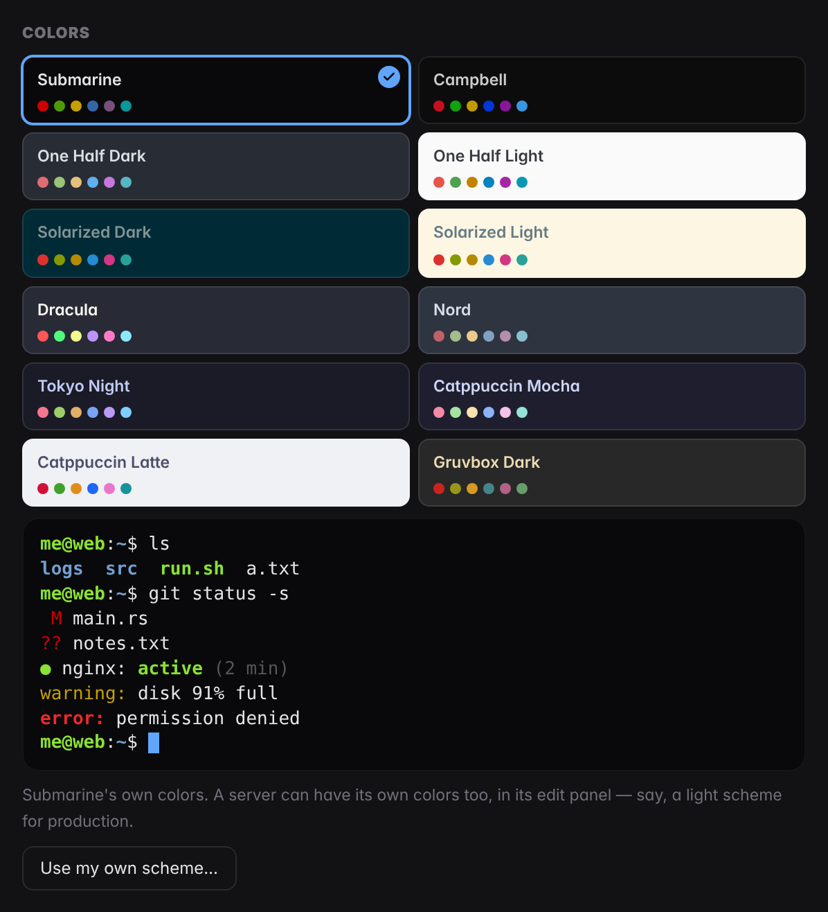
      <br/><sub><b>Color schemes</b>: Campbell, One Half, Solarized, Dracula, Nord, Tokyo Night, Catppuccin, Gruvbox, with a preview, or one of your own from Windows Terminal. A server can have its own, and it syncs with it.</sub>
    </td>
    <td width="50%" valign="top" align="center">
      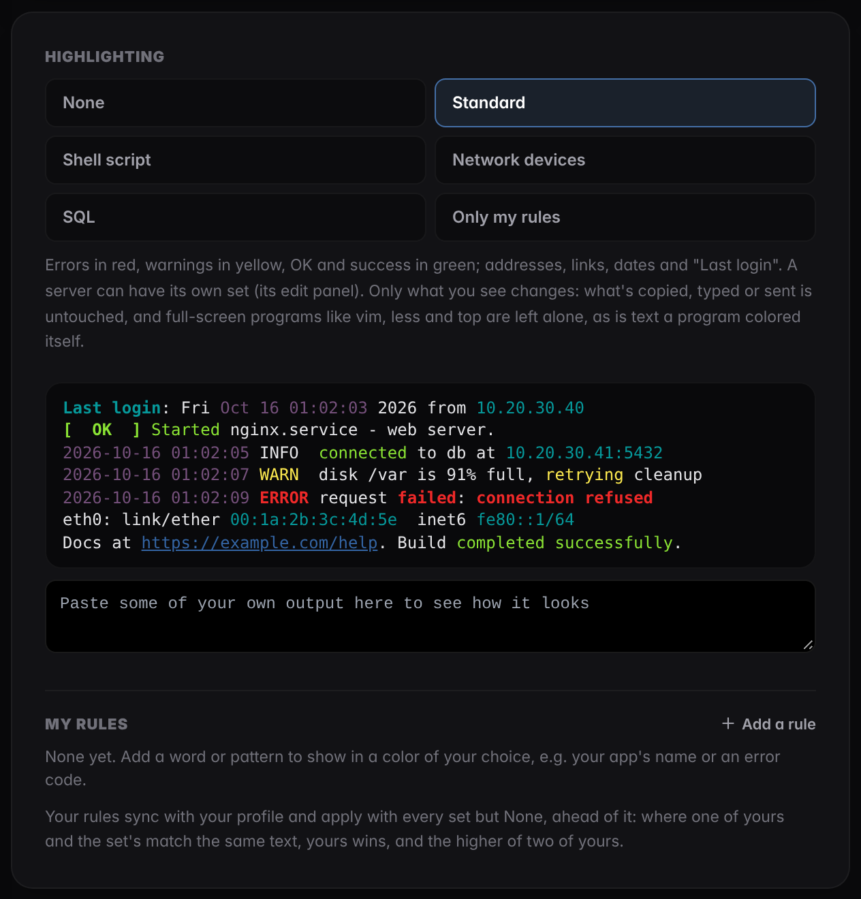
      <br/><sub><b>Syntax highlighting</b>: errors, warnings, OK, addresses, links and dates colored in the output. There are sets for shell scripts, network devices and SQL, a set per server, and rules of your own that sync with your profile.</sub>
    </td>
  </tr>
</table>

**Right-click a file name in a terminal** ([#40](https://github.com/paulm981/Submarine/issues/40)): on a name that looks like a path (`/etc/nginx/nginx.conf`, `app.log`, `src/main.rs:12`), a menu offers **Paste** first, then **Copy path** and **Edit locally on** the tab's server, which opens it in your editor with Live Edit and saves it back. A relative name is found from the folder your shell reports (the same report SFTP's Follow uses); without one, only a full path can be edited, and once the shell reports another host (an `ssh` onward), nothing is, until it's back. The name is read as the terminal shows it, past wide characters and across a wrapped line. Anywhere else, on a prompt (`paul@box:~$`) or with text selected, right-click pastes as before. Not in a Home terminal or a container's, nor for a folder, and it edits as your login, not as root after `sudo -i` ([#209](https://github.com/paulm981/Submarine/issues/209)). **Show in SFTP** is still to come.

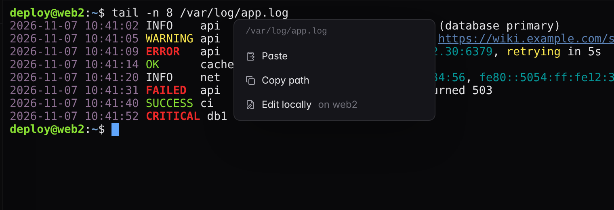

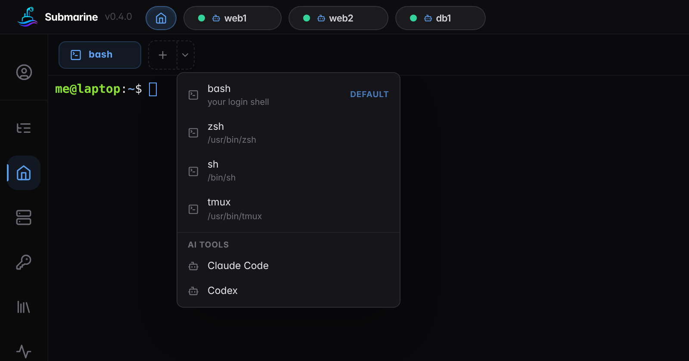

**A Home view** of terminals on your own computer:

- on Windows: PowerShell, Command Prompt, Git Bash, and each WSL distribution by name, with the default one marked;
- on macOS and Linux: your login shell and every other installed shell.

Also:

- **xterm.js 6**, drawn on the GPU.
- **Fast output never freezes the window.** Output is paced by what the screen has drawn, and floods of escape sequences that would lock it up are ignored.
- **The app's own dark right-click menus** everywhere. No right-click or F5 reloads the app.
- **Sessions that survive a reconnect** ([#126](https://github.com/paulm981/Submarine/issues/126)). Turn on **Keep sessions between connections** in Settings › Servers & sessions (off until you do), or for one server in its settings (Use the default, Always, Never), and new terminals run in tmux on the server, or in screen where there's no tmux. Nothing ever asks: a dropped connection, sleep or a closed tab leaves the session running, and connecting again takes you back to the same shell, with what was running still running. Type `exit` to end one. A kept terminal's tab has a small mark. **Sessions…** in a server's right-click menu lists them, to open one or end it. On-connect commands go only into a new session. It's this computer's choice and never synced, nothing is installed on a server, and a server with neither gets a plain shell and a one-line note. The work is in `keep_session.rs` and `KeptSessions.tsx`.

<table>
  <tr>
    <td width="50%" valign="top" align="center">
      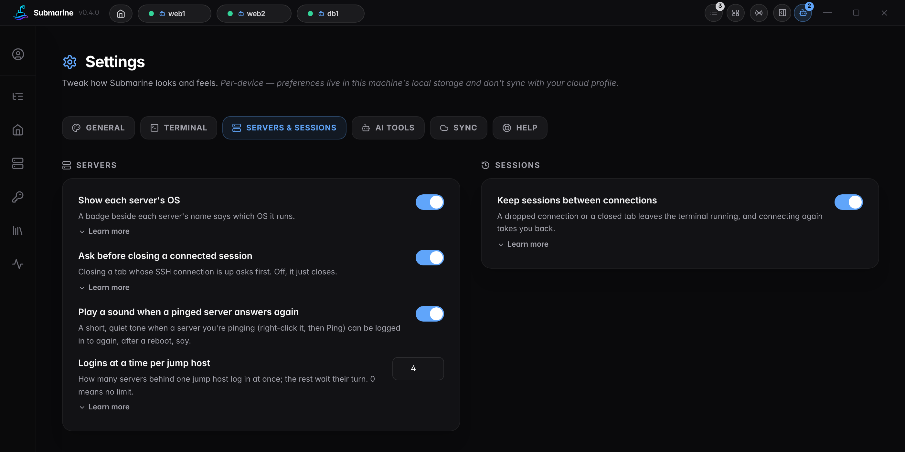
      <br/><sub><b>Keep sessions between connections</b>, in Settings › Servers & sessions</sub>
    </td>
    <td width="50%" valign="top" align="center">
      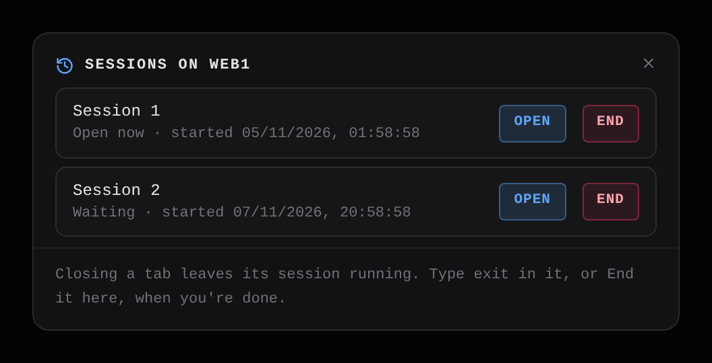
      <br/><sub><b>Sessions…</b> in the session tree lists a server's kept sessions</sub>
    </td>
  </tr>
</table>

### Your data, your storage

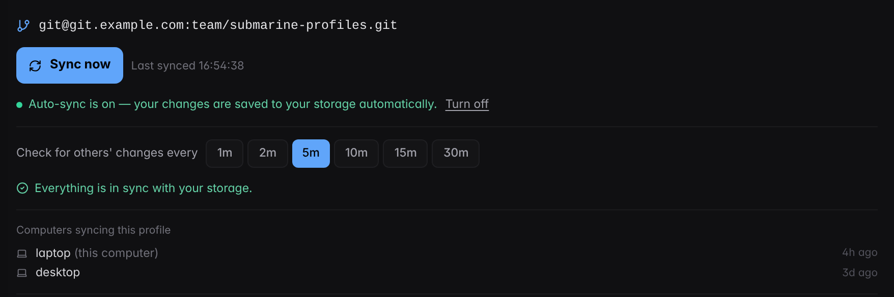

**Sync through storage you own.** The storage can be:

- a folder that OneDrive, Dropbox, Nextcloud, Syncthing or a network share keeps the same on your computers;
- a private git repository.

No third-party service is involved. Profiles are encrypted with their password before they leave your computer. The original project's hosted cloud stays off unless you turn it on.

### Ready to roll out to a team

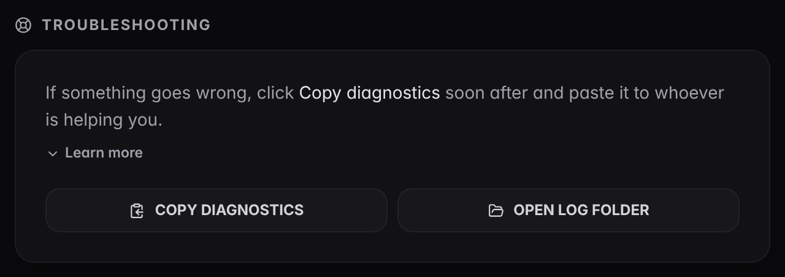

- **Troubleshooting.** The app keeps a log on your computer, and a watchdog notes when the window froze and why. **Copy diagnostics** copies the log with server, user and host names replaced, ready to send to whoever is helping.
- **A failed connect says why:** under the error, whether the name resolved and to what, and whether the port answered, through the jump host or proxy when there is one.
- **A release from every change**, numbered like `v0.4.0-fork.8` and shown in the title bar, with a notice when there's a newer one.
- **Hardening.** On every system, characters that disguise a file name are shown plainly, and a trusted server that shows a different kind of key is a warning, not a silent change. What a file from a server may run is under [Files](#files).

## Where it behaves differently

These are choices the fork makes on purpose. Each was weighed against staying close to the original project.

| Area | The original project | This fork |
|---|---|---|
| Profile sync | Its hosted cloud, `submarine.sinaxhpm.com` | A folder or git repository you own. The hosted cloud is off unless you turn it on. |
| Updates | Releases of the original project | Releases of this fork, one for every change: `v0.4.0-fork.1`, `v0.4.0-fork.2`, … |
| Live Edit | Refuses a program; on Windows opens a script in Notepad; opens anything else with its default app ([#212](https://github.com/SinaXhpm/submarine/pull/212)) | Refuses a program, and opens anything else in an editor: the one picked in Settings, or Notepad on Windows, the default text editor on macOS, and on Linux the text editor set for plain text. It never runs a file |
| Root | `sudo` | `sudo` or `dzdo`, and `dzdo su -`. A server without an sftp-server uses the original project's shell file access, under `sudo` only. |
| Docker | As the user | As the user, or through root where only root may use Docker |
| Remote Desktop | RDP servers ([#173](https://github.com/SinaXhpm/submarine/pull/173)), opened in the system's RDP app or, experimentally, in the tab ([#199](https://github.com/SinaXhpm/submarine/pull/199)) | The same: Remote Desktop is the original project's code, as they have it ([#160](https://github.com/paulm981/Submarine/issues/160)). The fork only brings RDP servers in: its own Remote Desktop links from before are moved over as RDP servers set to open in the system's app (`rdp_links.rs`), and the MobaXterm import brings RDP sessions in as RDP servers, without their saved login ([#42](https://github.com/paulm981/Submarine/issues/42)) |
| VNC password | The server's own, or its saved login's | The server's own only. VNC sends its password with weak protection and doesn't check the server's identity, so a saved login, shared with other servers, is never sent there |
| A server switched to telnet or VNC by another computer | Switched at once | In a shared profile, held on this computer, like synced on-connect commands: it stays what it was (SSH, or RDP) on its old port here until you allow the switch, or keep it as it was, which changes it back everywhere. Telnet and VNC would send its saved password where it could be read. A held switch stays held if you leave the share |
| Paste | The webview's clipboard | Read by the app itself, since the webviews on Windows, macOS and Linux refuse the page |
| Text fields on macOS | Capitalize and correct what's typed | Keep exactly what's typed |
| Closing a connected session | Always asks | Asks, unless you turn that off in Settings |
| A server moved by someone else in a shared profile ([#285](https://github.com/SinaXhpm/submarine/pull/285)) | Asks before it connects to the new address, and holds its commands and forwards again | The same, from every way a server is opened (a tab, or many at once from the session tree). A switch to telnet or VNC is held as before, and stays what it was here until allowed, so it isn't a move yet |
| Opening a profile automatically on Windows ([#275](https://github.com/SinaXhpm/submarine/pull/275), [#281](https://github.com/SinaXhpm/submarine/pull/281)) | For any profile, once turned on | Never for a shared profile: anyone using that Windows account would get everyone's saved logins. It can't be turned on for one, and sharing a profile turns it off (`secret_policy.rs`, E5) |
| Mac and iPhone builds ([#274](https://github.com/SinaXhpm/submarine/pull/274)) | A signed universal Mac app, iOS and the App Store, built with each release (`apple.yml`) | `apple.yml` is kept as it is but never run: the fork's Mac app is the Apple silicon build added to a release once it's been tried (`build.yml`) |
| On-connect commands | Typed once the terminal is open, on the first connect; with "each new terminal" ticked, once into each terminal opened later ([#175](https://github.com/SinaXhpm/submarine/pull/175), [#265](https://github.com/SinaXhpm/submarine/pull/265)) | Typed once the shell has printed its login banner, on the first connect and after a reconnect; with "each new terminal" ticked, into each of the tab's terminals too. Held ones are asked about once for all of them |
| Terminal output | Events, paced by what the window has drawn ([#263](https://github.com/SinaXhpm/submarine/pull/263)) | Paced the same way, but sent over a binary channel instead of events: on Windows, fewer scripts pass through the window's own thread, which handles its keys too |
| Saved password at a prompt ([#182](https://github.com/SinaXhpm/submarine/pull/182)) | Offers this server's password and every saved login | Offers this server's password and its own login; another saved login only when the prompt names its user. Not in Home's local shells |
| Terminal colors ([#183](https://github.com/SinaXhpm/submarine/pull/183)) | One scheme per device, or one of your own | The fork's schemes, per device or per server (synced). A scheme of your own is for this device only. "Keep text readable" is on by default |
| Key exchange ([#189](https://github.com/SinaXhpm/submarine/pull/189)) | Offers the 1024-bit `diffie-hellman-group1-sha1` last | Never offers it (Logjam). Group exchange over SHA-1 is offered, with groups of 2048 bits or more |
| Privacy policy ([#225](https://github.com/SinaXhpm/submarine/pull/225)) | The **Privacy** links open the policy on its website | They open this fork's [PRIVACY.md](PRIVACY.md): the same policy, with a note on where the fork differs. **Delete Submarine Cloud account** only deletes the hosted cloud account; profiles on the computer and sync through your own storage stay |
| Logins to a jump host ([#169](https://github.com/SinaXhpm/submarine/pull/169)) | No queue: every server opened behind a jump host logs in to it at once | Each jump host on the way waits its turn (**Logins at a time per jump host**, in **Settings › Servers & sessions**), one line per jump host address, shared by a saved jump host and the same machine in a chain; a jump host reached through another has its own line for that way there. A jump host holds its turn only while it logs in ([#43](https://github.com/paulm981/Submarine/issues/43)) |
| A saved jump host and `~/.ssh/config` ([#169](https://github.com/SinaXhpm/submarine/pull/169)) | A server's own jump host or proxy wins over its config's ProxyJump; a saved jump host's own ProxyJump is followed | The same. A saved jump host's own saved jump host still isn't followed, so chains only ever come from this computer's `~/.ssh/config`, never from synced servers ([#43](https://github.com/paulm981/Submarine/issues/43)) |
| Jump hosts in one route ([#169](https://github.com/SinaXhpm/submarine/pull/169)) | At most 8 levels of ProxyJump lists, so lists inside lists can add up to many more jump hosts | At most 8 jump hosts in all, counting every list and a saved jump host ([#43](https://github.com/paulm981/Submarine/issues/43)) |
| `%` in a ProxyJump | Taken as written | Refused with a message: Submarine doesn't fill in `%h`, `%r` and the like there yet ([#43](https://github.com/paulm981/Submarine/issues/43)) |
| Monitoring and ProxyJump | A server behind a config ProxyJump isn't checked; monitoring has no jump hosts | Monitoring goes through saved jump hosts. A server or a jump host that `~/.ssh/config` reaches through a ProxyJump isn't checked, and the card says why: monitoring can't ask for the jump hosts' passwords ([#43](https://github.com/paulm981/Submarine/issues/43)) |
| Host keys in `~/.ssh/known_hosts` ([#170](https://github.com/SinaXhpm/submarine/pull/170)) | A key listed there is trusted, before the app's own trusted keys are looked at. A different key of the same kind listed there brings the changed-key warning ([#285](https://github.com/SinaXhpm/submarine/pull/285)) | The app's own trusted keys (in your vault) come first. A key listed in known_hosts only skips the first-time question: a key that changed still gets the warning, even if known_hosts lists the new one. If known_hosts lists a different key for the server, you get the changed-key warning. A host certificate whose key isn't the one the app trusts gets the same changed-key warning; a certificate that doesn't check out is refused. A key marked `@revoked` is always refused, by Monitoring too ([#43](https://github.com/paulm981/Submarine/issues/43)) |
| Keys known_hosts vouches for ([#170](https://github.com/SinaXhpm/submarine/pull/170)) | Trusted each time, never saved | Saved to the app's trusted keys the first time, as if you had approved it, so Monitoring can check the server and a later change gets the warning. A host certificate isn't saved unless you accept its key at the changed-key warning; Monitoring says it can't check a server only a certificate vouches for, until its key is saved ([#43](https://github.com/paulm981/Submarine/issues/43)) |
| Key files and certificates from `~/.ssh/config` ([#170](https://github.com/SinaXhpm/submarine/pull/170)) | IdentityFile and CertificateFile are offered, certificates whatever their dates | The same, with "Use settings from ~/.ssh/config" on. A certificate that has expired or isn't valid yet is skipped, and the log says so. As with ssh-agent keys, they're offered to every server the setting applies to, including servers from a shared profile. A key file goes through the same cost limit as a saved key ([#43](https://github.com/paulm981/Submarine/issues/43)) |
| Turning known_hosts on and off ([#170](https://github.com/SinaXhpm/submarine/pull/170)) | Follows "Use settings from ~/.ssh/config" | The same, with no separate switch: off, known_hosts and the config's key files aren't read at all ([#43](https://github.com/paulm981/Submarine/issues/43)) |
| `HostKeyAlgorithms` in `~/.ssh/config` ([#170](https://github.com/SinaXhpm/submarine/pull/170)) | Its list decides which host keys are asked for first | Within its list, the kinds of key the app already trusts for the server are still asked for first, so a server with several keys doesn't look changed ([#43](https://github.com/paulm981/Submarine/issues/43)) |
| "Save password" in a shared profile ([#241](https://github.com/SinaXhpm/submarine/pull/241)) | The tick starts on | It starts off, and a line under it says everyone in the profile gets the password ([#121](https://github.com/paulm981/Submarine/issues/121)) |
| A VNC password typed at its prompt ([#241](https://github.com/SinaXhpm/submarine/pull/241)) | Saved to the server's saved login when it has one | Saved only into the server itself: no tick when it has a saved login, which VNC's weak protection mustn't carry ([#121](https://github.com/paulm981/Submarine/issues/121)) |
| What "Save password" saves ([#241](https://github.com/SinaXhpm/submarine/pull/241)) | The last password the server asked for, wherever the server's record points when the login ends | Only the first password a server asks for, only for the server's saved login name, and nothing if the server was changed while you logged in ([#121](https://github.com/paulm981/Submarine/issues/121)) |
| VNC clipboard ([#247](https://github.com/SinaXhpm/submarine/pull/247)) | Text copied on the server goes to this computer's clipboard at once | Only while its tab is in front and the window has the focus ([#121](https://github.com/paulm981/Submarine/issues/121)) |
| Website ([#229](https://github.com/SinaXhpm/submarine/pull/229)) | `website/` is published at `submarine.sinaxhpm.com` | The folder comes along with merges, unchanged, but the fork doesn't publish it: no workflow builds or deploys it |

## Changes in the original project not taken yet

Every change up to [#297](https://github.com/SinaXhpm/submarine/pull/297) is taken. Where the fork takes one differently, the table above says so.

Not taken yet, for the next sync:

| The original project's change | Why not yet |
|---|---|
| Nothing at the moment | |

## Keeping up with the original project

**Seeing what's new.** In Settings › Help, under Updates, turn on **Watch the original project**. The profile screen then says when the original project has changes the fork doesn't have yet, and links to GitHub's view of them. Nothing checks on a schedule: when the maintainer wants a rundown, with a recommendation for each change, they ask for one, and nothing is merged until they say so. Don't use GitHub's **Sync fork** button: the fork has commits of its own, and Sync fork offers to discard them.

**When.** At the start of every batch of work, before anything else, so the fork never falls far behind. A small sync each time is easier than a big one later.

**Where the fork's code is.** Every line the fork changes in one of the original project's files can conflict at a sync, so the fork keeps its code in files of its own:

- **Rust, in `src-tauri/src`.** Fork rules have files of their own, listed in step 4 below. So do the fork's features: `ai/` (the AI tools: the MCP server, approvals, root, copying, following and the audit log), `keep_session.rs`, `store_sync.rs`, `ping.rs`, `local_term.rs` (Home's shells), `highlight.rs`, `multiexec.rs` (the login queue per jump host), `term_output.rs`, `bulk_pick.rs` and others. Fork code in `lib.rs` is kept to one-line hooks into these modules, checked by `fork_hooks.rs`.
- **The page, in `src`.** `src/fork/desktop` (the main window), `src/fork/terminal` (a terminal), `src/fork/session` (a server tab), `src/fork/server-form` (the add/edit server form), `src/fork/grid` (the server grid), `src/fork/profile` (the Profile panel), `src/fork/bulk` (push and pull on many servers) and `src/components/settings/*` (the Settings tabs and the fork's own cards in them). Components only the fork has, such as `AiPanel.tsx`, `AiSidePane.tsx`, `KeptSessions.tsx`, `PingPanel.tsx` and `SessionTree.tsx`, sit in `src/components`.
- **Checks that a merge kept the hooks:** `src-tauri/src/fork_hooks.rs` for Rust, `tools/test/fork-hooks.test.ts` for the page, and `tools/test/fork-overrides.test.ts` for the original project's lines the fork restyles. Step 4 says how each works.
- **The footprint:** `git fetch upstream && scripts/upstream-footprint.sh` counts the lines the fork changes inside the original project's files, the ones that can conflict, and lists the files with the most. Every pull request says what it does to that number. It should only go down, or stay as it is.

**Bringing it in.** A sync pull request, the same way every time:

1. **Look before merging.** `git fetch upstream`, then `git merge-tree --write-tree HEAD upstream/main` shows which files would conflict without touching anything. `git log HEAD..upstream/main` lists what's new.
2. **Decide first when a change collides with the fork.** If one of the original project's changes touches something the fork does its own way (security above all), write the choices down in an issue and settle them before writing code, as [#43](https://github.com/paulm981/Submarine/issues/43) did for ProxyJump and known_hosts (D1 to D8). Then bring such changes in one pull request each, not all at once.
3. **Merge, don't cherry-pick:** `git merge upstream/main` on a branch. That keeps the history saying what came from where, and leaves the original project's changes as they were, so the next merge has less to sort out. Record a change you leave out with `git merge -s ours <its commit>` and a message saying why. Take it later with `git cherry-pick -x <its commit>`, so the commit says where it came from.
   - **A sync done in steps** (as [#121](https://github.com/paulm981/Submarine/issues/121) was, one pull request per group of changes) cherry-picks each group with `-x`. Its last step ends with `git merge upstream/main`: by then every change is in, so the merge brings nothing new, but it records that the original project's history is in. Without it, the next sync would offer the same changes again.
4. **Resolve conflicts toward the original project's text** as it is on its main now. Then put the fork's behavior back the way that changes their code least:
   - **Fork rules live in fork-only files,** called from one-line hooks in the shared code: `hop_policy.rs` (jump hosts), `trust_policy.rs` (host keys), `jump_gone.rs` (a deleted jump host), `secret_policy.rs` (saved passwords, and a shared profile never opening by itself), `remote_sh.rs` (commands run as root), `root_ssh.rs` (root over SSH: sudo or dzdo, and the password typed in Submarine). Fork code with no rule in it lives in files of its own too, out of `lib.rs` ([#136](https://github.com/paulm981/Submarine/issues/136)): the features listed under **Where the fork's code is** above, and code moved out of the shared files, such as `live_edit.rs`, `downloads.rs`, `remote_writes.rs`, `connect_diag.rs`, `session_import.rs`, `firewall.rs`, `diagnostics.rs`, `synced_tunnels.rs`, `sync_diff.rs`, `server_look.rs`, `clone_server.rs`, `vault_schema.rs` (the fork's columns and tables in a profile), `sync_merge.rs` (what a server's sync record carries, and the batch a sync merges), `clipboard_read.rs` (with `windows_clipboard.rs`, a paste's clipboard on Windows and macOS), `profile_create.rs` and `key_format_tests/fork.rs`. In `lib.rs` the fork's `mod` lines sit together, after the original project's own list. One thing to watch: the batch a sync merges (`merge_batch`) now lives only in `sync_merge.rs`, so a change the original project makes to its own `merge_batch` comes in as a conflict on a deleted function and has to be carried into `sync_merge.rs` by hand. Fork code that belongs with one of the original project's files sits in a child file beside it (`ssh_manager/root_state.rs`, `approvals/held_switch.rs` and others), brought in with `mod x; pub(crate) use x::*;` where it was, and the fork's tests in their test modules sit in a `fork.rs` child file. A conflict then touches one line, not the rule.
   - **A rule file's tests prove the rule, not just the function:** they run on the app's own tables (`sync_engine_tests::device`, or the statement a new vault is made with, `fork_hooks::app_table`) and go through the same steps the app does. Each rule file's `the_hooks_are_in_place` names its hooks and the function each one sits in (`fork_hooks::assert_hooks`), and fails naming any a merge lost or moved. A call left in a test, or a comment, doesn't count. A new rule file, or fork code moved out of the shared code, gets the same ([#136](https://github.com/paulm981/Submarine/issues/136)).
   - **The page's hooks** (the original project's `.tsx` files importing the fork's modules) are checked by `tools/test/fork-hooks.test.ts` (from the repository root, `npm --prefix tools/test ci` once, then `npm --prefix tools/test test`): it names each such import, file by file, and fails naming any a merge lost. A hook added or removed on purpose updates its table ([#61](https://github.com/paulm981/Submarine/issues/61)). The main window's fork code lives in `src/fork/desktop/` ([#163](https://github.com/paulm981/Submarine/issues/163)), which `DesktopApp.tsx` reaches through one import, `* as Fork`, and one-line `Fork.…` hooks; a terminal's lives in `src/fork/terminal/`, which `TerminalView.tsx` reaches the same way, and a server tab's in `src/fork/session/`, which `SessionView.tsx` does; likewise `src/fork/server-form/` for `AddNodePanel.tsx`, `src/fork/grid/` for `NodeGrid.tsx` and `src/fork/profile/` for `ProfilePanel.tsx`. The table lists those hooks too, under `uses`, so a merge that drops one fails the same way. The Settings tabs and the fork's cards are in `src/components/settings/`, which `SettingsPanel.tsx` reaches through one import; push and pull on many servers is in `src/fork/bulk/`, reached through `src/fork/desktop/` and the session tree's menu. Where the fork restyles one of the original project's elements, it spreads its own attributes after the original's (`{...Fork.paneLook(…)}`); `tools/test/fork-overrides.test.ts` records the original's lines each spread overrides and fails when a sync changes them, so a change there (a class that hides a pane, say) is looked at, not silently overridden.
   - **Code waiting on the original project** gets a comment, `// fork: until upstream #NNN`, so it's easy to find and drop once they take the fix.
   - **A safety fix the merge itself needs** goes in the first commit, so no commit in the history is unsafe.
5. **Say what's different.** Anything taken differently goes in the [table above](#where-it-behaves-differently), anything not taken in [not taken yet](#changes-in-the-original-project-not-taken-yet) with a backlog item, and the "up to #N" line at the top moves on.
6. **Check it:**
   - the pull request's checks: the tests on Linux and Windows, clippy, the page's tests, and the TypeScript check and page build. They run by themselves, and main only takes a pull request that passes them;
   - `src-tauri/src/lib.rs` keeps its Windows line endings (CRLF) on every line, as the original project has it; a file that changes them conflicts on every line at the next merge;
   - a security review of the merged result, its findings fixed before merging;
   - the app itself, against a test server: terminal, SFTP and SFTP root mode, a folder of servers behind a jump host opened at once, and Monitoring. Whatever wasn't tried is said plainly in the pull request;
   - the changelog lines, in a file of their own in `changelog.d/` named after the sync's issue, never in CHANGELOG.md itself (**Versions**, below, says how they get there). A file there holds lines, not headings, so each line ends with the original project's pull requests, as in "(Their [#263](https://github.com/SinaXhpm/submarine/pull/263); [#142](https://github.com/paulm981/Submarine/issues/142))";
   - the footprint, before and after (`scripts/upstream-footprint.sh`).
7. **Merge it.** GitHub publishes it as the next release.

**Versions.**

- **Every merge to main is a release.** GitHub builds it and publishes it, tagged with the original project's version and the fork's count: `v0.4.0-fork.1`, `v0.4.0-fork.2`, and so on. A higher count is newer. There's nothing to tag by hand.
- **The title bar shows it,** as in `v0.4.0-fork.8`, and the profile screen says when there's a newer release.
- **When the original project releases a new version** and it's merged, the count starts again. Releases on 0.3.8 ran from `v0.3.8-fork.1` to `v0.3.8-fork.11`; with 0.4.0 in, they're `v0.4.0-fork.1` and on.
- **The installers keep the same names** in every release, so a link to the latest release's `Submarine-windows-x64-setup.exe` always gets the newest. On Windows the installer itself can only say `0.4.0`; the app still knows it's `0.4.0-fork.8`.
- **Windows and Linux are in every release; macOS is added to one once it has been tried,** since a macOS minute costs ten of the account's GitHub Actions minutes. **Run workflow** with **Or: add the Mac build to this release** set to its tag builds the Mac app from that release's code and adds it to the release. Only a release with its Windows installer gets one. Or build it on your own Mac: [Builds on GitHub](README.md#builds-on-github) says how.
- **The changelog fills itself in.** A pull request with something a person using the app will notice adds a file to `changelog.d/`, named after its issue (`126.md`), holding its line or lines. When the merge is released, the release job moves the released commit's files into CHANGELOG.md under that release's number and deletes them (`scripts/changelog_release.py`). Two pull requests then never change the same lines. A file merged after the release was built waits for the next one. [changelog.d/README.md](changelog.d/README.md) shows the format.
- **Before `v0.3.8-fork.1`,** the fork numbered its builds instead (build 244 was the last). Those builds are told about the new releases.

**Giving back.** Fixes that apply to the original project too go back to it as pull requests.
