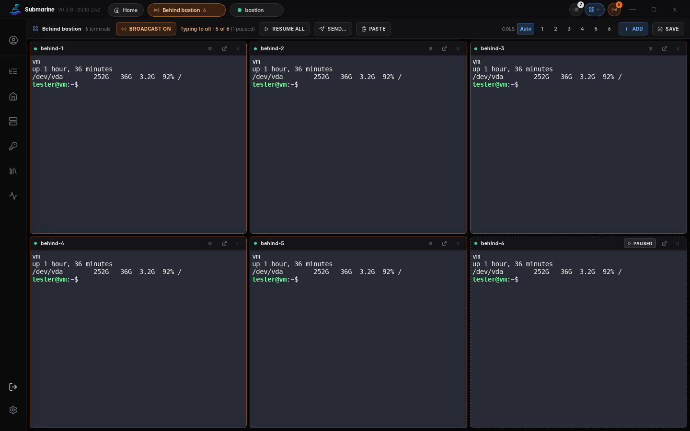
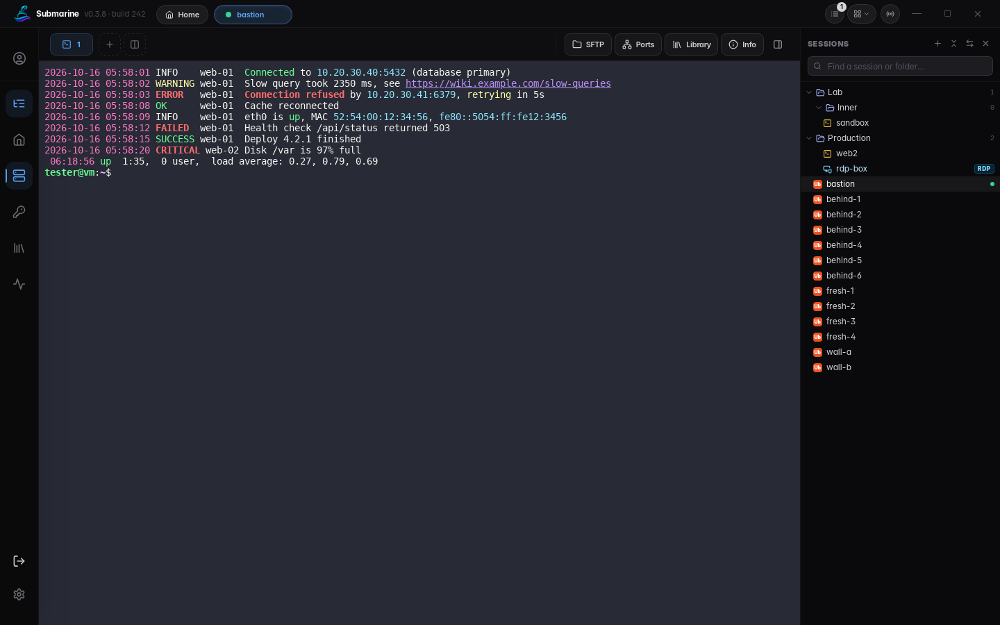
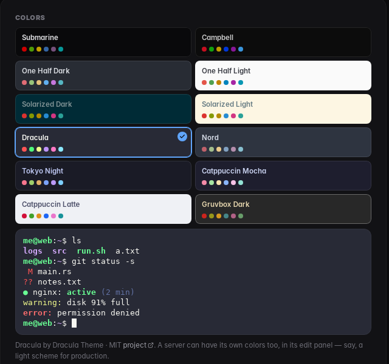
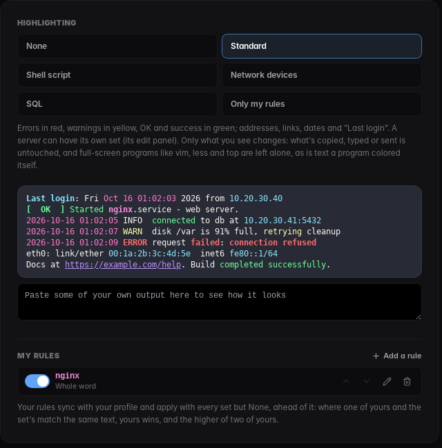
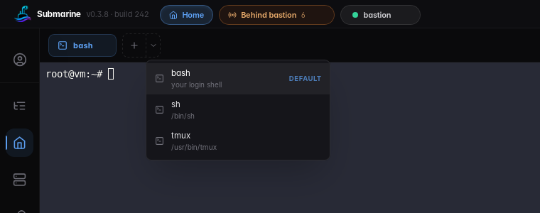
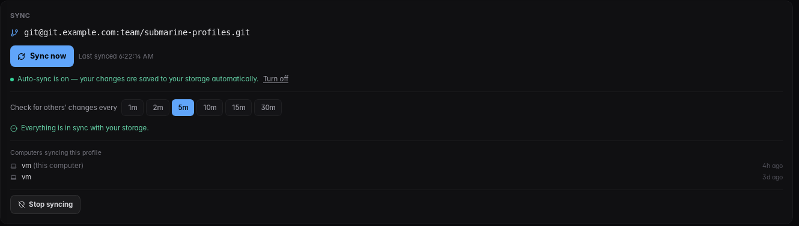
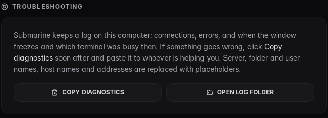

# About this fork

[paulm981/Submarine](https://github.com/paulm981/Submarine) is a fork of [Submarine](https://github.com/SinaXhpm/submarine) by Sina. It aims to be the SSH client and session manager a team needs for a large, shared set of servers, on Windows, macOS and Linux alike, while staying as close to the original project as it can.

This page covers:

- [What this fork adds](#what-this-fork-adds), with pictures
- [Where it behaves differently](#where-it-behaves-differently) from the original
- [Changes in the original project not taken yet](#changes-in-the-original-project-not-taken-yet), and why
- [How it keeps up with the original project](#keeping-up-with-the-original-project), and how releases are numbered

What changed in each release is in [CHANGELOG.md](CHANGELOG.md).

The fork is based on the original project's **0.4.0**, with every change up to [#224](https://github.com/SinaXhpm/submarine/pull/224) brought in or recorded as not taken.

## What this fork adds

### Work on many servers at once

**Walls with broadcast input.** Terminals from many servers sit side by side. With Broadcast on, what you type goes to all of them. You can:

- click into one terminal to type to it alone, and use **Type to all** to go back;
- pause the terminals to leave out: one with its chip, several by Ctrl-clicking (⌘-clicking) their titles or Shift-clicking a run, or **Pause all** and then resume the few you want;
- paste, or **Send** a set of commands, to all of them.

A server that connects or reconnects partway through a line waits for the next line, so it never gets only the end of a command. Walls can be saved by name, and a whole folder opens as one.

- **Jump hosts at scale.** A hundred servers behind one jump host log in a few at a time; the number is a setting. Monitoring reaches servers through their jump host too.
- **Split.** A second shell on the same server opens beside the first, so you can watch a log in one and work in the other.
- **Many tabs.** **Ctrl+Shift+K** opens All tabs with its search ready: type part of a name and press Enter. **Ctrl+Tab** and **Ctrl+Shift+Tab** move between tabs. A tab's right-click menu closes the other tabs, the ones to its right, the disconnected ones, or all of them.

### Organize them

- **A session tree** beside the terminal, with search. It holds folders, servers and Remote Desktop links, and you manage it with drag and drop, rename, move and delete. **Show only open** (the eye button) narrows it to the servers you have open.
- **Remote Desktop links** are saved with your servers and open in Remote Desktop Connection on Windows.
- **OS badges** on servers, and a look of their own for Remote Desktop links.

### Bring your sessions with you

**Session import that keeps your setup.** The MobaXterm import keeps everything below as it was:

- nested folders;
- saved logins;
- jump hosts and their keys;
- startup commands such as `dzdo su -`;
- Remote Desktop sessions.

A result screen says what came in. PuTTY and OpenSSH config imports are there too.

### AI help, without sharing keys

A first test, off by default: turn it on in **Settings › AI tools**.

- **Claude Code from Home's menu**, under AI tools, opens already connected to Submarine through a local channel only your account can use. Nothing listens on the network.
- **Share with AI** on a server's tab lets that AI tab ask to run commands there. Each one waits in the **AI panel** (the title bar's AI button) until you click Allow or Deny; typing can't approve anything.
- Submarine runs the command over its own connection, so the AI never gets a key or password. You see the full output; the AI gets it with known secrets hidden, and you see how many.
- Every request and decision goes in `ai-audit.log` in the log folder.

What comes next (root prompts, the AI asking for a server, many servers, downloads, more AI tools) is in [#32](https://github.com/paulm981/Submarine/issues/32).

### Root when you need it

Root works through `sudo` or `dzdo` (Centrify / Delinea), without a password where the server allows it, including servers that only allow `dzdo su -`. Where a password is needed, the app asks for it. It works in three places:

- **SFTP root mode**: browse and edit files as root;
- **the Info panel**: start, stop and restart services, end processes, and read firewall rules as root;
- **the Docker tab**: where only root may use Docker, containers, logs, live logs and container terminals work through root.

### A better terminal

<table>
  <tr>
    <td width="50%" valign="top" align="center">
      
       <b>Color schemes</b>: Campbell, One Half, Solarized, Dracula, Nord, Tokyo Night, Catppuccin, Gruvbox, with a preview, or one of your own from Windows Terminal. A server can have its own, and it syncs with it.
    </td>
    <td width="50%" valign="top" align="center">
      
       <b>Syntax highlighting</b>: errors, warnings, OK, addresses, links and dates colored in the output. There are sets for shell scripts, network devices and SQL, a set per server, and rules of your own that sync with your profile.
    </td>
  </tr>
</table>

**A Home view** of terminals on your own computer:

- on Windows: PowerShell, Command Prompt, Git Bash, and each WSL distribution by name, with the default one marked;
- on macOS and Linux: your login shell and every other installed shell.

Also:

- **xterm.js 6**, drawn on the GPU.
- **Fast output never freezes the window.** Output is paced by what the screen has drawn, and floods of escape sequences that would lock it up are ignored.
- **The app's own dark right-click menus** everywhere. No right-click or F5 reloads the app.

### Your data, your storage

**Sync through storage you own.** The storage can be:

- a folder that OneDrive, Dropbox, Nextcloud, Syncthing or a network share keeps the same on your computers;
- a private git repository.

No third-party service is involved. Profiles are encrypted with their password before they leave your computer, and Remote Desktop links sync too. The original project's hosted cloud stays off unless you turn it on.

### Ready to roll out to a team

- **Troubleshooting.** The app keeps a log on your computer, and a watchdog notes when the window froze and why. **Copy diagnostics** copies the log with server, user and host names replaced, ready to send to whoever is helping.
- **A failed connect says why:** under the error, whether the name resolved and to what, and whether the port answered, through the jump host or proxy when there is one.
- **Two uploads to the same file**, or an upload and a Live Edit save, wait their turn instead of mixing and corrupting it.
- **A release from every change**, numbered like `v0.4.0-fork.2` and shown in the title bar, with a notice when there's a newer one.
- **Hardening.** On every system:
  - characters that disguise a file name are shown plainly;
  - a trusted server that shows a different kind of key is a warning, not a silent change;
  - Live Edit opens a file in an editor and never runs it: the one picked in Settings, or else Notepad on Windows, the default text editor on macOS, and on Linux the plain-text editor for a file that could run;
  - the Local pane asks before it opens a file that would run (a program, a script, a shortcut; on macOS a `.terminal` or `.command` file too).

  Downloads are marked as from the internet on Windows and macOS. As in the original project ([#212](https://github.com/SinaXhpm/submarine/pull/212)), a program on a server (`.exe`, `.msi`, `.jar`, `.AppImage`, …) isn't opened from the file pane at all.

## Where it behaves differently

These are choices the fork makes on purpose. Each was weighed against staying close to the original project.

| Area | The original project | This fork |
|---|---|---|
| Profile sync | Its hosted cloud, `api.sinaxhpm.com` | A folder or git repository you own. The hosted cloud is off unless you turn it on. |
| Updates | Releases of the original project | Releases of this fork, one for every change: `v0.4.0-fork.1`, `v0.4.0-fork.2`, … |
| Live Edit | Refuses a program; on Windows opens a script in Notepad; opens anything else with its default app ([#212](https://github.com/SinaXhpm/submarine/pull/212)) | Refuses a program, and opens anything else in an editor: the one picked in Settings, or Notepad on Windows, the default text editor on macOS, and on Linux the plain-text editor for a file that could run. It never runs a file |
| Root | `sudo` | `sudo` or `dzdo`, and `dzdo su -`. A server without an sftp-server uses the original project's shell file access, under `sudo` only. |
| Docker | As the user | As the user, or through root where only root may use Docker |
| Remote Desktop | RDP servers ([#173](https://github.com/SinaXhpm/submarine/pull/173)), opened in the system's RDP app or, experimentally, in the tab ([#199](https://github.com/SinaXhpm/submarine/pull/199)) | The same RDP servers, each with its **Open in** choice of the built-in client or the system's app, per device. Beside them, the fork's Remote Desktop links, imported from MobaXterm and synced, and marked LINK so they aren't taken for RDP servers. Joining Remote Desktop links and RDP servers is next ([#42](https://github.com/paulm981/Submarine/issues/42)) |
| VNC password | The server's own, or its saved login's | The server's own only. VNC sends its password with weak protection and doesn't check the server's identity, so a saved login, shared with other servers, is never sent there |
| A server switched to telnet or VNC by another computer | Switched at once | In a shared profile, held on this computer, like synced on-connect commands: it stays an SSH server on its old port here until you allow the switch, or keep it SSH, which changes it back everywhere. Telnet and VNC would send its saved password where it could be read. A held switch stays held if you leave the share |
| RDP, telnet and VNC servers on Walls | Not pinned to a Wall | Not on a Wall either, even when their folder or a saved Wall is opened as one, so a screen never gets Broadcast keys |
| Paste | The webview's clipboard | Read by the app itself, since the webviews on Windows, macOS and Linux refuse the page |
| Text fields on macOS | Capitalize and correct what's typed | Keep exactly what's typed |
| Closing a connected session | Always asks | Asks, unless you turn that off in Settings |
| On-connect commands | Typed once the terminal is open, on the first connect ([#175](https://github.com/SinaXhpm/submarine/pull/175)) | Typed once the shell has printed its login banner, on the first connect and after a reconnect |
| Walls | One Wall of pinned copies of terminals; a copy sets the terminal's size while it's open ([#180](https://github.com/SinaXhpm/submarine/pull/180)) | Walls of their own, each showing the terminals themselves, so a terminal has one size. Broadcast, saved Walls, and Rows ([#190](https://github.com/SinaXhpm/submarine/pull/190)), which aren't saved with a saved Wall yet |
| Saved password at a prompt ([#182](https://github.com/SinaXhpm/submarine/pull/182)) | Offers this server's password and every saved login | Offers this server's password and its own login; another saved login only when the prompt names its user. Not in Home's local shells |
| Terminal colors ([#183](https://github.com/SinaXhpm/submarine/pull/183)) | One scheme per device, or one of your own | The fork's schemes, per device or per server (synced). A scheme of your own is for this device only. "Keep text readable" is on by default |
| Key exchange ([#189](https://github.com/SinaXhpm/submarine/pull/189)) | Offers the 1024-bit `diffie-hellman-group1-sha1` last | Never offers it (Logjam). Group exchange over SHA-1 is offered, with groups of 2048 bits or more |

## Changes in the original project not taken yet

| Change | Why not yet | What's next |
|---|---|---|
| [#169](https://github.com/SinaXhpm/submarine/pull/169) ProxyJump from `~/.ssh/config` | It changes the connect path that the fork's jump hosts are built on: their login queue, and Monitoring through a jump host. | A careful merge that keeps both. |
| [#170](https://github.com/SinaXhpm/submarine/pull/170) Teleport and OpenSSH certificates; trusting `known_hosts` | It builds on #169, and changes how host keys are trusted. | With #169. |

## Keeping up with the original project

**Seeing what's new.** In Settings › Updates, turn on **Watch the original project**. The profile screen then says when the original project has changes the fork doesn't have yet, and links to GitHub's view of them. The maintainer also gets a weekly check, Monday mornings, that lists them with a recommendation for each. Don't use GitHub's **Sync fork** button: the fork has commits of its own, and Sync fork offers to discard them.

**Bringing it in.** A sync pull request, the same way every time:

1. On a branch, merge the original project's main: `git fetch upstream && git merge upstream/main`. Merging, not cherry-picking, keeps the history saying what came from where. It also leaves the original project's changes as they were, so the next merge has less to sort out.
2. Resolve conflicts by keeping both sides. Where the fork does something differently, keep the fork's way and say so in the table above.
3. Anything not taken goes in the table above with the reason, and gets a backlog item. Record it in git so the next merge doesn't bring it in unseen: `git merge -s ours <its commit>`, with a message saying why. That takes no changes, and the update check stops counting it. To take it later, cherry-pick it.
4. Check it:
   - the pull request's checks: the tests on Linux and Windows, clippy, and the TypeScript check and page build. They run by themselves, and main only takes a pull request that passes them;
   - the app itself, against a test server: terminal, SFTP and SFTP root mode, a Wall behind a jump host, and Monitoring;
   - lines in [CHANGELOG.md](CHANGELOG.md).
5. Merge it. GitHub publishes it as the next release.

**Versions.**

- **Every merge to main is a release.** GitHub builds it and publishes it, tagged with the original project's version and the fork's count: `v0.4.0-fork.1`, `v0.4.0-fork.2`, and so on. A higher count is newer. There's nothing to tag by hand.
- **The title bar shows it,** as in `v0.4.0-fork.2`, and the profile screen says when there's a newer release.
- **When the original project releases a new version** and it's merged, the count starts again. Releases on 0.3.8 were `v0.3.8-fork.1` and on; with 0.4.0 in, they're `v0.4.0-fork.1` and on.
- **The installers keep the same names** in every release, so a link to the latest release's `Submarine-windows-x64-setup.exe` always gets the newest. On Windows the installer itself can only say `0.4.0`; the app still knows it's `0.4.0-fork.2`.
- **Before `v0.3.8-fork.1`,** the fork numbered its builds instead (build 244 was the last). Those builds are told about the new releases.

**Giving back.** Fixes that apply to the original project too go back to it as pull requests.
