<div align="center">
  
  <h1>Submarine — SSH Client &amp; Session Manager</h1>
  <p><strong>A full-featured SSH and SFTP client and session manager for Windows, macOS and Linux.</strong></p>
  <p>Organize hundreds of servers, work on many at once, edit remote files, forward ports, and sync folders from one native window. Bring your sessions over from MobaXterm, PuTTY or an OpenSSH config. Built with Rust and Tauri.</p>
  <p>
    <a href="https://github.com/paulm981/Submarine/releases/latest"></a>
    <a href="https://github.com/paulm981/Submarine/actions/workflows/build.yml"></a>
    <a href="https://github.com/paulm981/Submarine/releases/latest"></a>
    <a href="https://github.com/paulm981/Submarine/releases"></a>
    
    
  </p>
</div>

> **This is a fork.** [paulm981/Submarine](https://github.com/paulm981/Submarine) builds on [Submarine](https://github.com/sinaxhpm/submarine) by Sina. It adds what a team needs to run a large, shared set of servers from one SSH client that works the same on Windows, macOS and Linux: AI tools that can work on your servers without ever getting a key, files pushed to or pulled from many servers at once, sessions that survive a dropped connection, and an easy way in for anyone coming from MobaXterm, PuTTY or an OpenSSH config. **Download** the [latest release](https://github.com/paulm981/Submarine/releases/latest) (on Windows, [`Submarine-windows-x64-setup.exe`](https://github.com/paulm981/Submarine/releases/latest/download/Submarine-windows-x64-setup.exe); see [Install](#install)). Releases, updates and issues for this fork live here.

## What this fork adds

[FORK.md](FORK.md) has more on each feature below, with pictures, along with where the fork differs from the original project and how it keeps up with it. What changed in each release is in [CHANGELOG.md](CHANGELOG.md).

<table>
  <tr>
    <td width="50%" valign="top" align="center">
      <a href="FORK.md#a-better-terminal">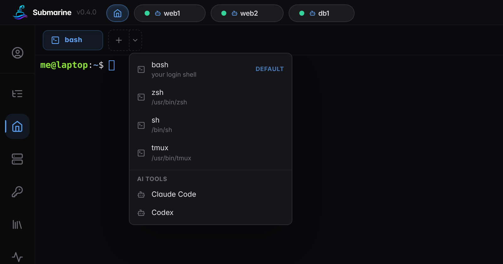</a>
      <br/><sub><b>Home</b>: terminals on this computer, beside your servers</sub>
    </td>
    <td width="50%" valign="top" align="center">
      <a href="FORK.md#organize-them">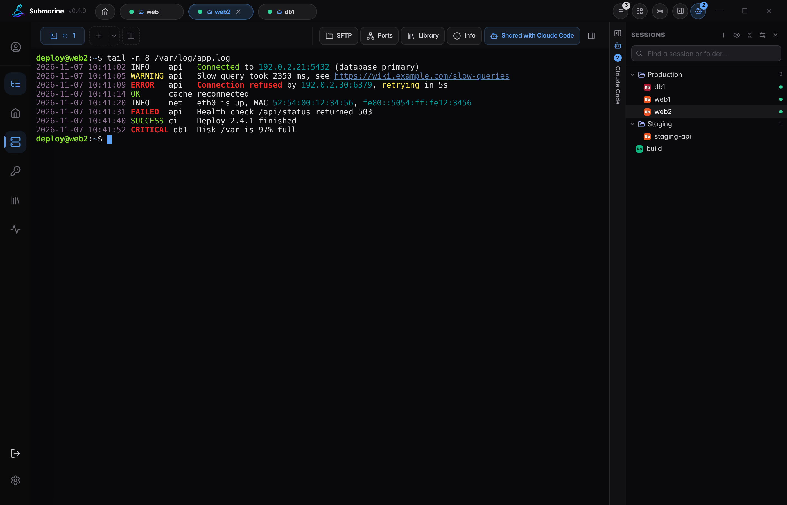</a>
      <br/><sub><b>Session tree and highlighting</b>: folders and servers; errors, warnings and addresses colored</sub>
    </td>
  </tr>
  <tr>
    <td width="50%" valign="top" align="center">
      <a href="FORK.md#a-better-terminal">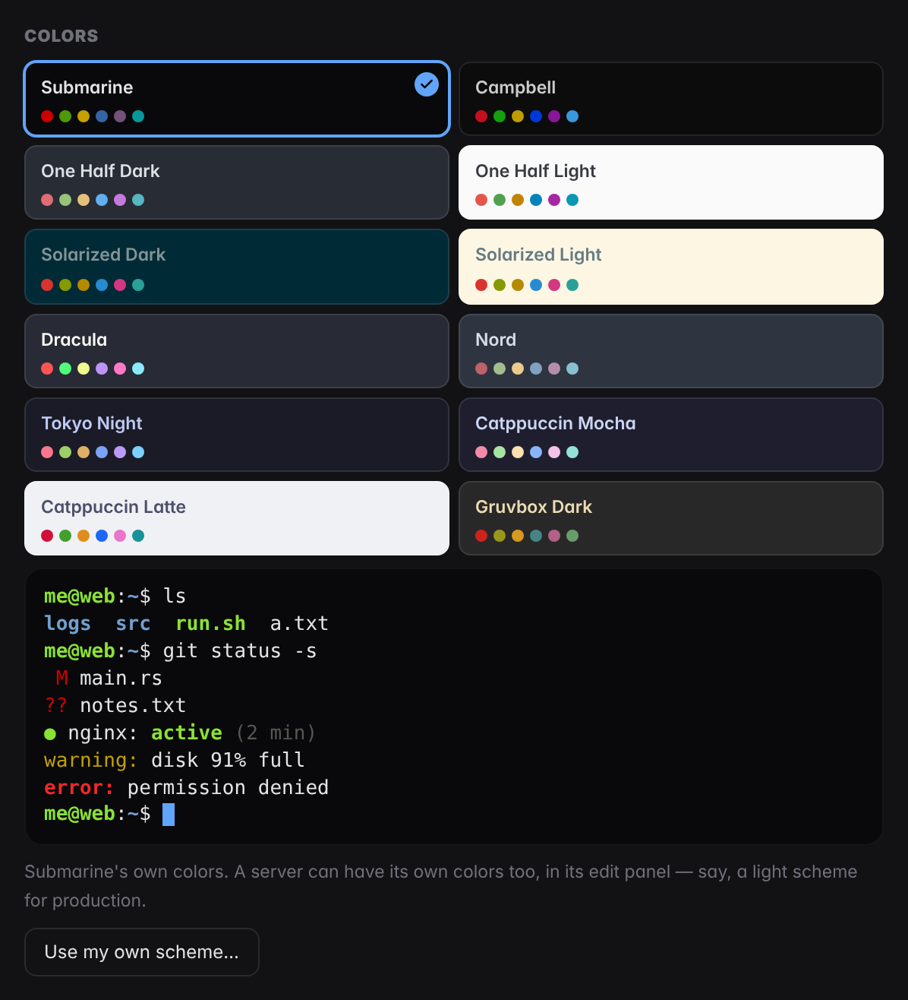</a>
      <br/><sub><b>Color schemes</b>, one for the app and one per server if you like</sub>
    </td>
    <td width="50%" valign="top" align="center">
      <a href="FORK.md#your-data-your-storage">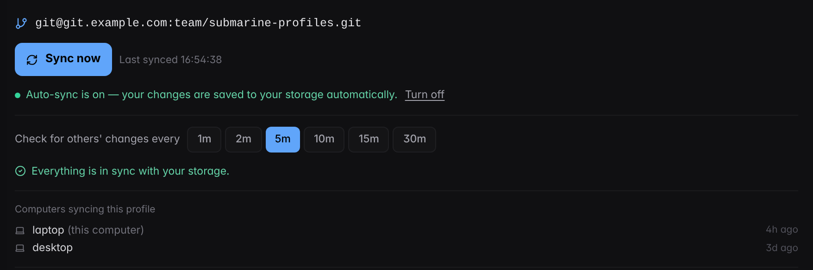</a>
      <br/><sub><b>Sync through storage you own</b>: a synced folder or a private git repository</sub>
    </td>
  </tr>
  <tr>
    <td width="50%" valign="top" align="center">
      <a href="FORK.md#ai-help-without-sharing-keys">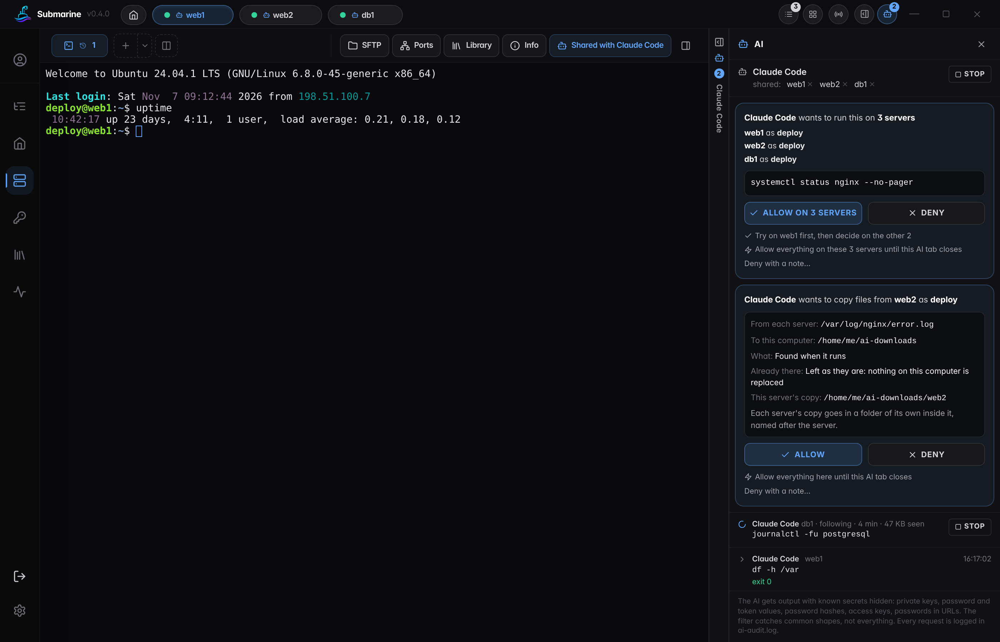</a>
      <br/><sub><b>AI tools</b>: every command waits for your Allow, one card for many servers</sub>
    </td>
    <td width="50%" valign="top" align="center">
      <a href="FORK.md#ai-help-without-sharing-keys">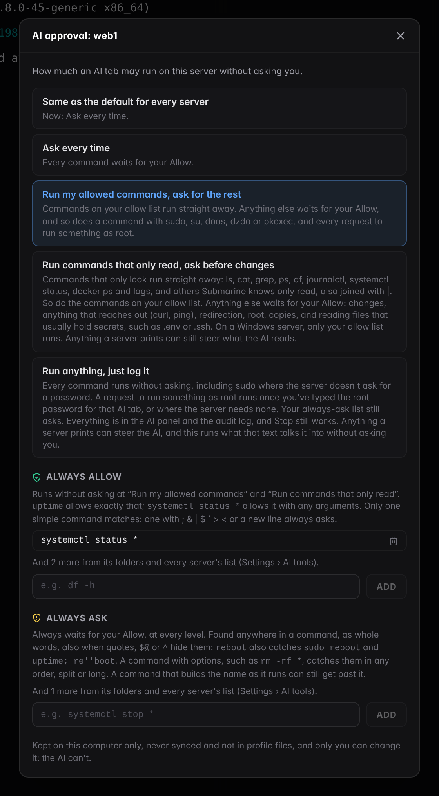</a>
      <br/><sub><b>How much the AI may run without asking</b>, per server</sub>
    </td>
  </tr>
  <tr>
    <td width="50%" valign="top" align="center">
      <a href="FORK.md#work-on-many-servers-at-once">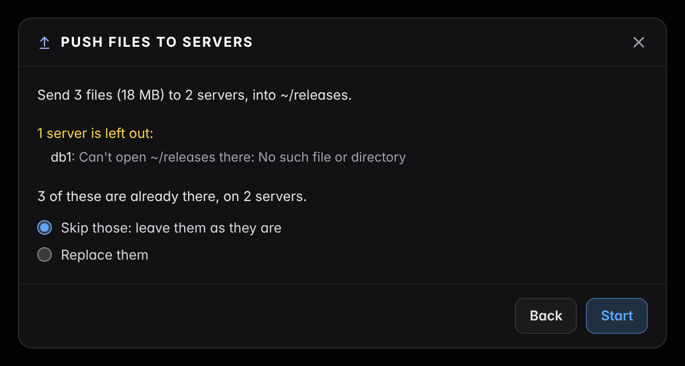</a>
      <br/><sub><b>Push files to many servers</b>, with a summary before anything moves</sub>
    </td>
    <td width="50%" valign="top" align="center">
      <a href="FORK.md#a-better-terminal">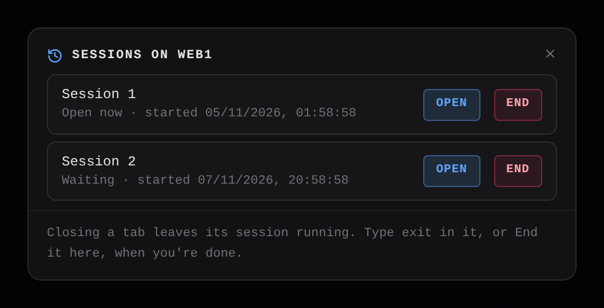</a>
      <br/><sub><b>Sessions that survive a reconnect</b>, listed per server</sub>
    </td>
  </tr>
</table>

**AI tools on your servers, without sharing keys** (a first test, off by default)
- **Claude Code or Codex from Home's menu.** Install one, turn on **Settings › AI tools**, then start it from Home's menu (the arrow beside **+**, then **AI tools**). It opens already connected to Submarine, through a local channel only your account can use.
- **Share with AI** on a server's tab, and the AI can ask to run commands there. Each request waits in the **AI panel** until you click Allow or Deny, on a card that says which server it runs on and as whom. **Ctrl+Shift+L** shows the AI beside the tab.
- **How much it may run without asking is up to you, per server or folder:** **Ask every time** (the default), **Run my allowed commands, ask for the rest**, **Run commands that only read, ask before changes**, or **Run anything, just log it** for lab servers. An always-ask list (`reboot`, `rm -rf *` and more) asks at every level. Your levels and rules stay on this computer and never sync.
- **"Work on staging-api"** while it isn't shared: the AI asks for it by name, and a card asks you **Share it?** It never gets a list of your servers.
- **One card for many servers.** The same command on 12 shared servers is one request: **Allow on 12 servers**, or **Try on web1 first** and see its result before the rest.
- **Root through Submarine.** The AI asks Submarine for root instead of typing sudo. Submarine runs the command through dzdo or sudo (`dzdo su -` included), and where your password is needed, you type it into Submarine. The AI never sees it.
- **Copying files.** The AI can push files to shared servers, or pull them from each, as one request on one card. Files come to this computer only into folders you add under **Settings › AI tools**, and never replace what's there.
- **Following a log.** It can follow a command such as `journalctl -u nginx -f` and read what's new every few seconds. The AI panel shows each follow, with **Stop**.
- **What a server prints is marked as the server's words.** The AI gets it between tags the server can't fake, with a line saying it's data, not instructions. That's a strong hint to the AI, not a guarantee.
- **The AI never gets a key or password.** Commands run on Submarine's own connection. Known secrets are hidden from the output the AI gets, and every request and decision goes in an audit log, `ai-audit.log`.
- **What it doesn't stop:** the AI tool still runs as you, so it could use keys it finds by itself, and a hostile program running as you could get round all of this. [FORK.md](FORK.md#ai-help-without-sharing-keys) says how to keep Claude Code out of your keys. What comes next is in [#32](https://github.com/paulm981/Submarine/issues/32).

**Work on many servers at once**
- **Broadcast on one screen**: tick servers in the Broadcast menu and their terminals open side by side on the Wall, their tabs folded into one Broadcast tab; what you type in any of them goes to all of them. Pop one out to its own tab from its tile. Type to one of them alone, or pause one, from its tile; a server that joins partway through a command waits for the next line. **Send…** types a set of commands into all of them. Right-click a folder in the session tree to Broadcast to all its servers. Unticking them all ends it. The original project's Broadcast and Wall, ticked and pinned for you. You can also pin any terminal to the Wall by hand (right-click its tab).
- **Push and pull files on many servers.** Right-click a tab, or servers in the session tree, and pick **Push files to servers…** or **Pull files from servers…**. Before anything moves, a summary shows what goes where and what's already there. Four servers copy at a time, and **Stop** stops them all.
- **Many tabs, easily**: **Ctrl+Shift+K** jumps to a tab by typing part of its name, **Ctrl+Tab** moves between tabs, and a tab's right-click menu closes the others, those to the right, the disconnected ones, or all of them.
- **Jump hosts at scale**: a hundred servers behind one jump host log in a few at a time (the limit is a setting), and Monitoring reaches servers through their jump host too. **Jump via** in the server form is a search box.
- **Your `~/.ssh/config`**: ProxyJump chains, IdentityFile keys and certificates (Teleport included), and your known_hosts. Submarine's own trusted host keys always come first, so a changed key always gets the warning. [More in FORK.md](FORK.md#jump-hosts-and-your-ssh-config).
- **Split**: a second shell on the same server beside the first, to watch a log in one and work in the other.

**Sessions that survive a reconnect**
- Turn on **Keep sessions between connections** in **Settings › Servers & sessions**, or for one server in its form. Terminals then run in tmux, or screen, on the server. After a dropped connection, a sleep or a closed tab, you're back in the same shell, with what was running still running.
- Nothing asks when you close a tab: the session just keeps running. Type `exit` to end it, or use **Sessions…** in the server's right-click menu. Nothing is installed on a server; one without tmux or screen gets a plain shell.

**Organize them**
- **A session tree** beside the terminal, with search: folders and servers (SSH, Remote Desktop, VNC and telnet), managed by drag and drop, rename, move and delete. **Show only open** narrows it to the servers you have open.
- **OS badges** on servers, and a badge for each server that isn't SSH.
- **Ping** a server from its right-click menu, while it reboots, say: a small panel shows when it stopped answering, when it came back, and when its port takes a connection again.

**Bring your sessions with you**
- **Session import that keeps your setup**: from MobaXterm, nested folders, saved logins, jump hosts and their keys, and startup commands such as `dzdo su -` come over as they were. Remote Desktop sessions come in as RDP servers, without their saved login. A result screen says what came in. PuTTY and OpenSSH config imports are there too.

**Root when you need it**
- **SFTP root mode, Info panel actions and Docker as root** through `sudo` or `dzdo` (Centrify / Delinea): without a password where the server allows it, including servers that only allow `dzdo su -`, and with csh or tcsh logins. A password you type goes only to sudo or dzdo, and a wrong one costs a single failed attempt, so it can't lock your account.

**A better terminal**
- **xterm.js 6** with color schemes (Campbell, One Half, Solarized, Dracula, Nord, Tokyo Night, Catppuccin, Gruvbox), and a scheme per server that syncs with it.
- **Syntax highlighting**: errors, warnings, OK, addresses, links and dates colored in the output, with sets for shell scripts, network devices and SQL, a set per server, and rules of your own that sync with the profile.
- **Fast output never freezes the window**: output is paced by what the screen has drawn, and floods of escape sequences that would lock it up are ignored.
- **A Home view** of terminals on your own computer: PowerShell, Command Prompt, Git Bash and each WSL distribution by name on Windows (the default one marked); the login shell and every other installed shell on macOS and Linux.
- The app's own dark right-click menus everywhere, and no right-click or F5 that reloads the app.

**Settings in categories**
- Tabs across the top: General, Terminal, Servers & sessions, AI tools, Sync and Help. Settings opens on the one you used last. Each setting says what it does in one line, with the longer explanation behind **Learn more**.

**Your data, your storage**
- **Sync through storage you own**: a folder that OneDrive, Dropbox, Nextcloud, Syncthing or a network share keeps the same on your computers, or a private git repository, with no third-party service. Profiles are encrypted with their password first. The original project's hosted cloud stays off unless you turn it on.

**Ready to roll out to a team**
- **A release from every change**, numbered like `v0.4.0-fork.N` and shown in the title bar, with a notice when there's a newer one.
- **Shared profiles that can't act behind your back**: when someone you share a profile with changes on-connect commands, autostart, forwards or monitor commands, or switches a server to telnet or VNC, it waits for your OK on your computer. [More in FORK.md](FORK.md#shared-profiles).
- **Troubleshooting**: a log on your computer, a watchdog that notes when the window froze and why, and **Copy diagnostics** with server, user and host names replaced, ready to send to whoever is helping. When a connect fails, Submarine says whether the name resolved and the port answered.
- **Hardening**: characters that disguise a file name are shown plainly, and a trusted server that shows a different kind of key is a warning, not a silent change. Live Edit opens a file in an editor and never runs it, and keeps changes that didn't reach the server in **Submarine unsent edits** in your Downloads folder. The Local pane asks before it opens a file that would run, on Windows, macOS and Linux. Downloads never replace each other, and are marked as from the internet on Windows and macOS. A mirror keeps a file's permissions on the server. As in the original project, a program on a server isn't opened from the file pane at all.
- **Close to the original project**: its changes come in through regular sync pull requests, and [FORK.md](FORK.md) lists where the fork differs and what it hasn't taken yet.

The original project's README follows.

---

<div align="center">
  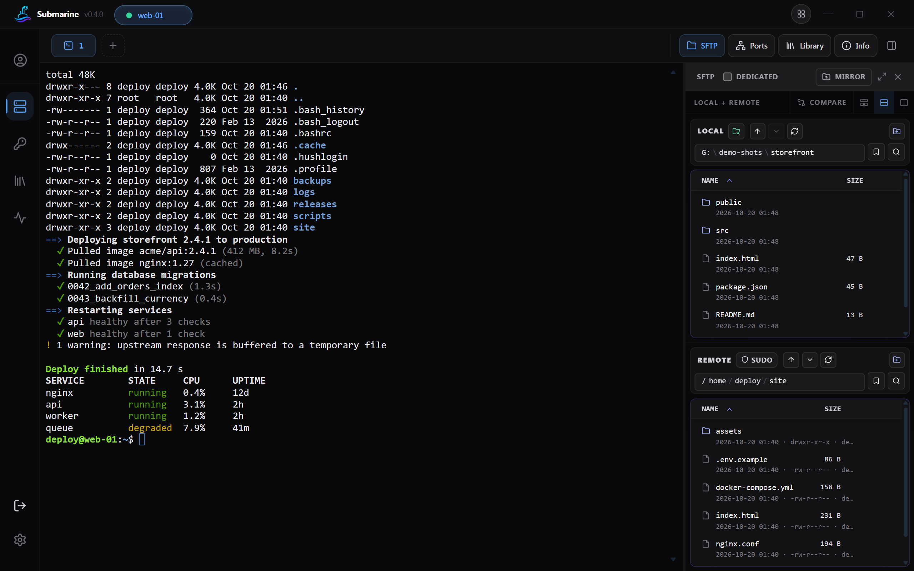
</div>

> **TL;DR** — Submarine is a free, open-source SSH, SFTP and FTP client for Windows, macOS, Linux and Android. It replaces the usual PuTTY + WinSCP + FileZilla + tunnel-manager (+ Remmina / VNC viewer) stack with one tabbed window per server: terminal, SFTP and FTP, port forwarding (SOCKS / HTTP / local / remote), folder mirror, server info, Docker, and RDP, VNC and Telnet sessions. Profiles are encrypted on your device, and optional cloud sync can keep them in step across your machines and your phone. Built with Rust and Tauri. MIT licensed.

## At a glance

- **SSH, SFTP, FTP and FTPS, Telnet, VNC and RDP in one app** — pick the type when you add a server; each opens as a tab (the terminal for SSH and Telnet, the file browser for FTP, the remote screen for VNC and RDP)
- **In 15 languages** — English, Deutsch, Español, Français, Italiano, Polski, Português (Brasil), Türkçe, Русский, Українська, हिन्दी, 日本語, 한국어, 中文（简体）and 中文（繁體）; it follows the system's language, or pick one in Settings → Language
- **One window, many tools per server** — terminal, SFTP, tunnels, folder mirror, Docker, live server info and a command library, all around the same session
- **Watch many servers at once** — split view for two sessions, a **Wall** pinboard for any terminals across hosts, and **broadcast input** to several sessions at once
- **Works with your existing SSH setup** — reads `~/.ssh/config` (Include, Match, ProxyJump, ProxyCommand, IdentityFile, certificates), logs in with keys from **ssh-agent / Pageant / the Windows OpenSSH agent**, trusts your `known_hosts`
- **Native and cross-platform** — Windows, macOS (one app for Apple Silicon and Intel), Linux (`.deb` / `.rpm` / Arch / AppImage) and Android, with iPhone and iPad builds for the App Store, and the same encrypted vault on all of them
- **Encrypted profiles** — Argon2id + AES-256-GCM on your device; open a profile with **Windows Hello** or an **Android fingerprint** if you turn that on
- **Optional cloud sync** — records are encrypted before upload; use the hosted server, or [point Submarine at your own](#cloud-sync-optional)
- **Import from anywhere** — PuTTY `.reg`, MobaXterm `.mxtsessions`, OpenSSH config and Submarine JSON exports
- **Honest about risk** — Telnet and plain VNC are labelled *not encrypted*, and the built-in RDP client is marked *experimental*

## Screenshots

<table>
  <tr>
    <td colspan="2" align="center">
      <a href="docs/screenshots/compare.png">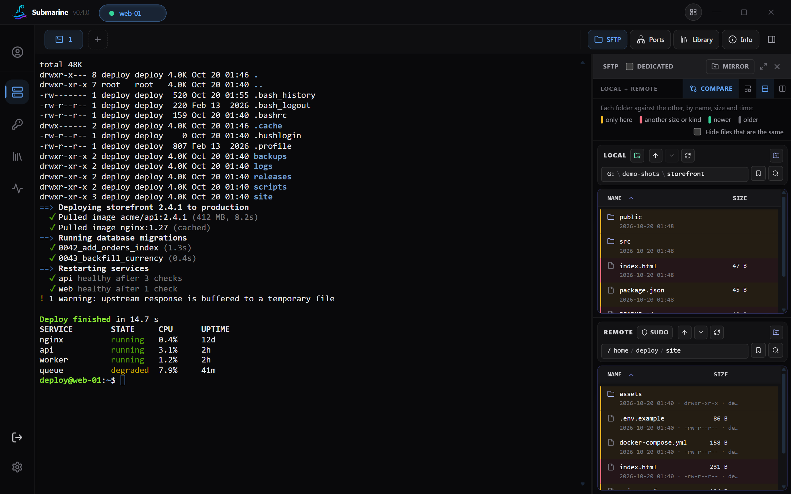</a>
      <br/><sub><b>Compare folders</b> — see at a glance what is only on one side, differs in size, or is newer or older, with a switch to hide files that are the same</sub>
    </td>
  </tr>
  <tr>
    <td width="50%" valign="top" align="center">
      <a href="docs/screenshots/vnc.png">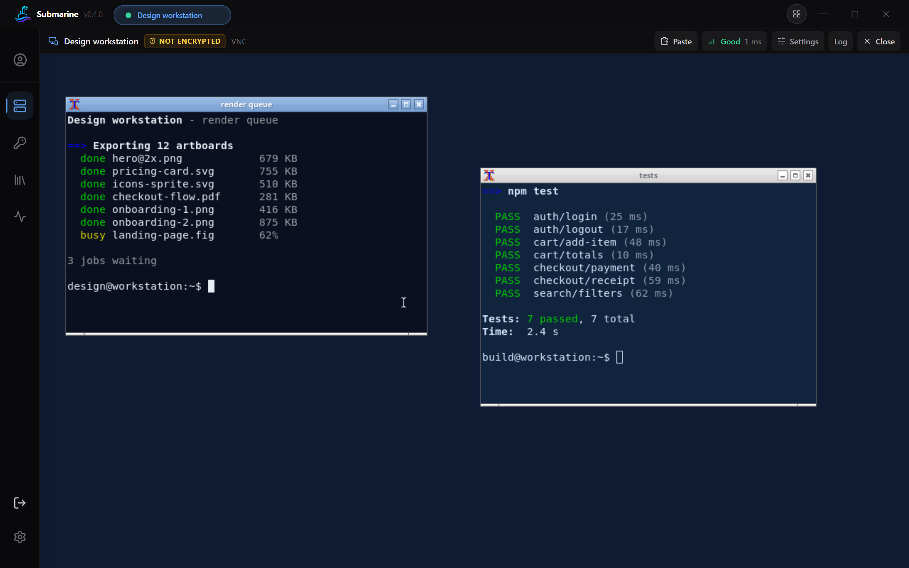</a>
      <br/><sub><b>VNC</b> — the remote screen in the tab, directly or through an SSH server, with a shared clipboard, the connection's quality and its speed settings; unencrypted VNC says so</sub>
    </td>
    <td width="50%" valign="top" align="center">
      <a href="docs/screenshots/rdp.png">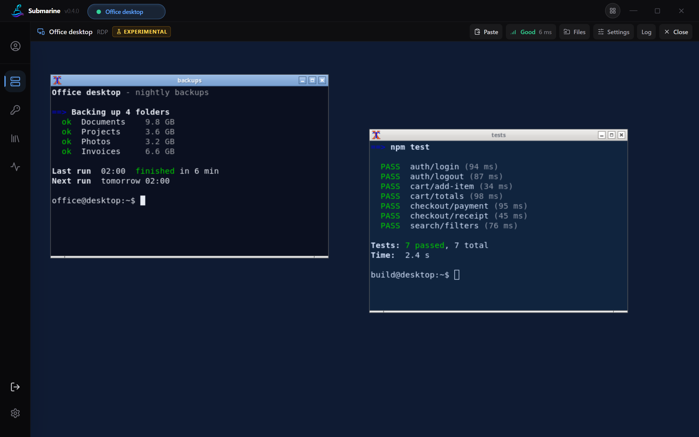</a>
      <br/><sub><b>RDP</b> — opens in your computer's RDP app by default; the built-in client (shown) is experimental and opt-in, and shares the clipboard and a folder or drive</sub>
    </td>
  </tr>
  <tr>
    <td colspan="2" align="center">
      <a href="docs/screenshots/wall.png">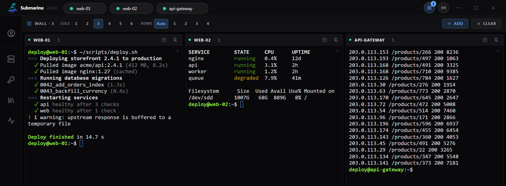</a>
      <br/><sub><b>The Wall</b> — pin terminals from any servers into one grid and watch them together</sub>
    </td>
  </tr>
  <tr>
    <td colspan="2" align="center">
      <a href="docs/screenshots/monitor.png">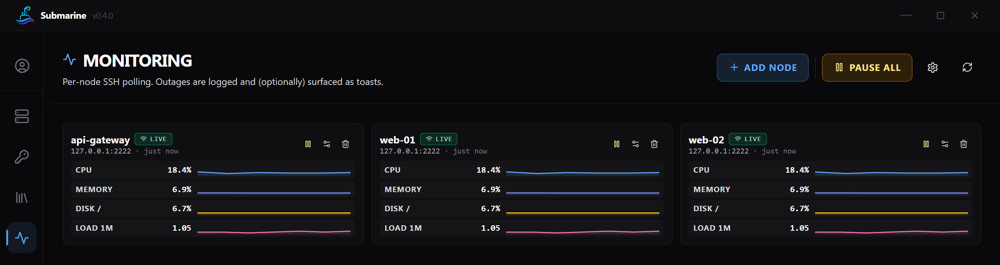</a>
      <br/><sub><b>Monitoring</b> — per-node SSH polling for CPU, memory, swap, disk, load and network, with graphs, outage log and your own custom metrics</sub>
    </td>
  </tr>
  <tr>
    <td colspan="2" align="center">
      <a href="docs/screenshots/servers-home-lab.png">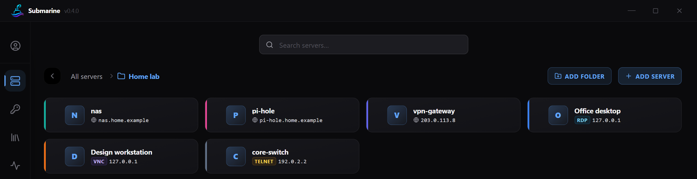</a>
      <br/><sub><b>Servers</b> — nested, colour-tagged folders with drag and drop; RDP, VNC and Telnet servers carry a badge</sub>
    </td>
  </tr>
</table>

<table>
  <tr>
    <td width="33%" valign="top" align="center">
      <a href="docs/screenshots/ports.png">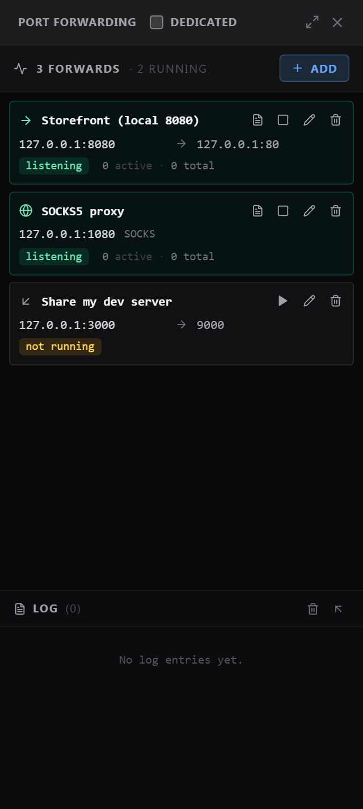</a>
      <br/><sub><b>Port forwarding</b> — local, remote and dynamic SOCKS / HTTP tunnels, named, started and stopped one by one</sub>
    </td>
    <td width="33%" valign="top" align="center">
      <a href="docs/screenshots/library-panel.png">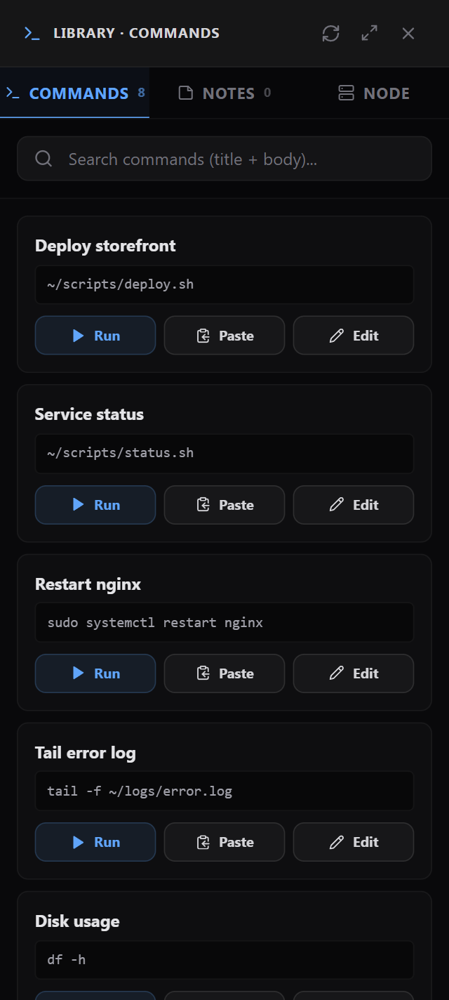</a>
      <br/><sub><b>Command library</b> — Run or Paste saved commands in the open session; notes and node details beside them</sub>
    </td>
    <td width="33%" valign="top" align="center">
      <a href="docs/screenshots/add-server.png">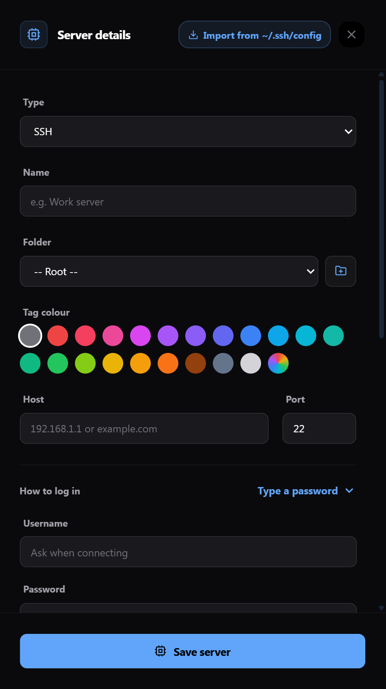</a>
      <br/><sub><b>Server form</b> — type (SSH / RDP / VNC / Telnet), folder, tag colour, login, proxy and tunnels in one place</sub>
    </td>
  </tr>
</table>

<table>
  <tr>
    <td width="50%" valign="top" align="center">
      <a href="docs/screenshots/profiles.png">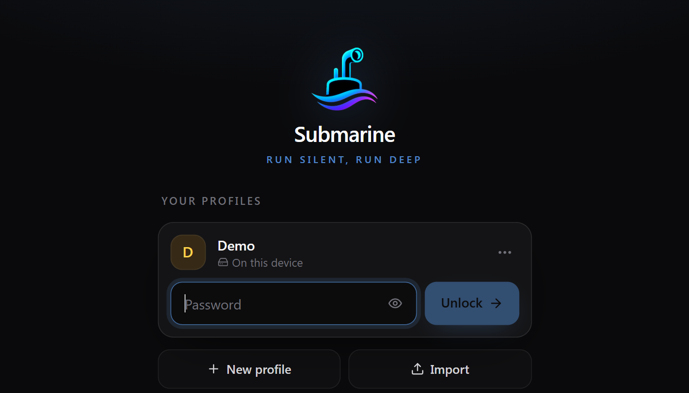</a>
      <br/><sub><b>Profiles</b> — each profile is its own encrypted vault, local or synced</sub>
    </td>
    <td width="50%" valign="top" align="center">
      <a href="docs/screenshots/terminal-colours.png">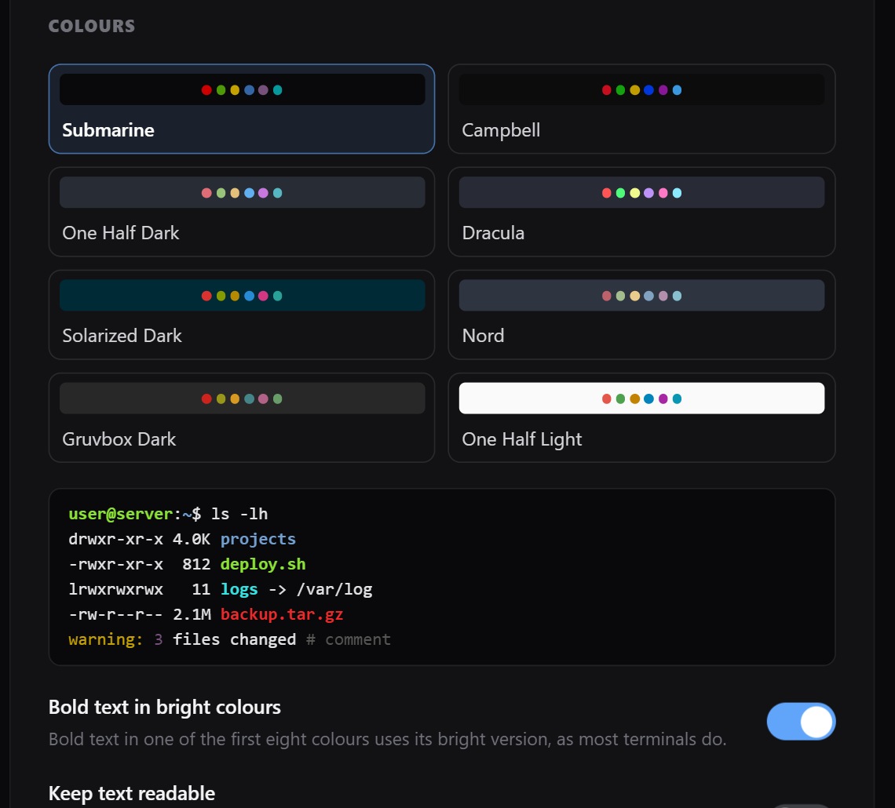</a>
      <br/><sub><b>Terminal colours</b> — built-in schemes, or bring your own from Windows Terminal</sub>
    </td>
  </tr>
  <tr>
    <td width="50%" valign="top" align="center">
      <a href="docs/screenshots/library.png">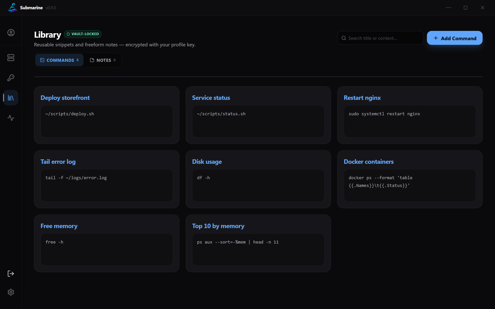</a>
      <br/><sub><b>Library</b> — commands and notes for all servers, or only for some of them</sub>
    </td>
    <td width="50%" valign="top" align="center">
      <a href="docs/screenshots/logins.png">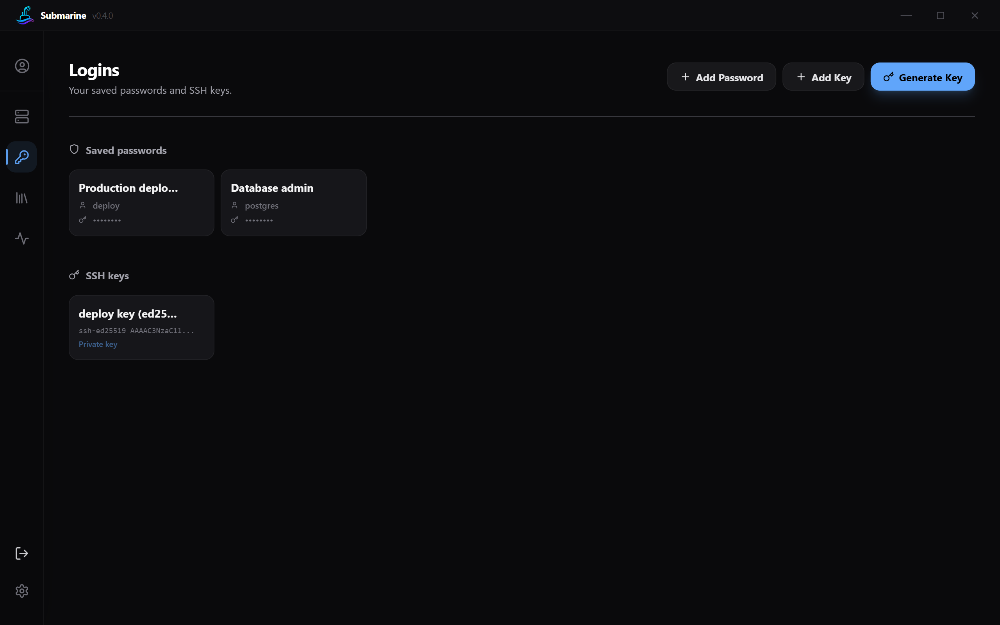</a>
      <br/><sub><b>Logins</b> — saved passwords and SSH keys, with built-in key generation</sub>
    </td>
  </tr>
</table>

<details>
<summary>More pictures: mirror, servers, settings, terminal</summary>

<p align="center">
  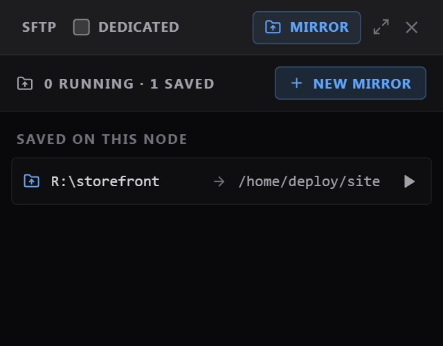
  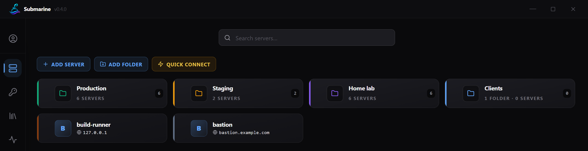
</p>
<p align="center">
  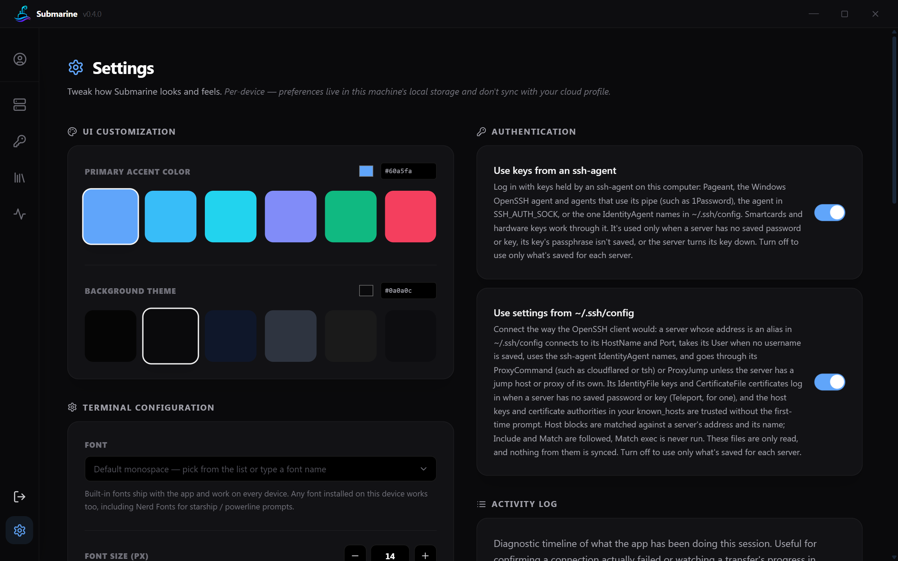
  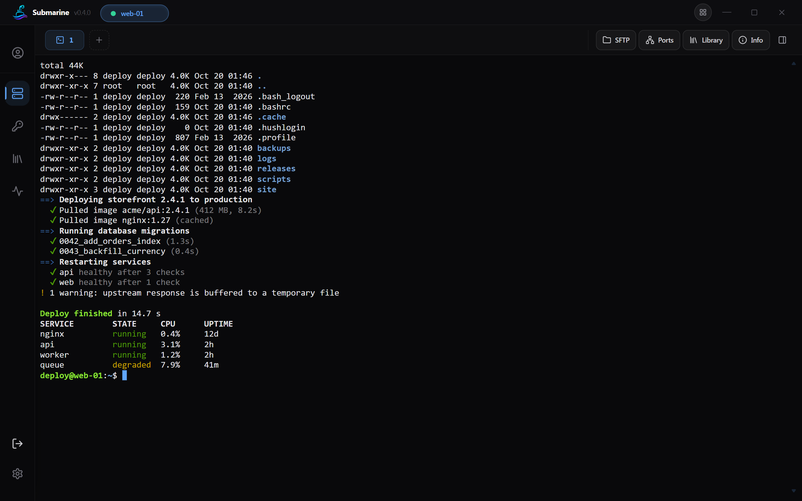
</p>

</details>

## Looking for an alternative to…

If you're searching for one of these, Submarine is a direct fit:

- a free **PuTTY alternative for macOS and Linux** (and a tabbed PuTTY replacement on Windows)
- a **WinSCP alternative** that lives in the same window as your terminal
- a place to take your **MobaXterm** sessions that also runs on macOS and Linux — the import keeps folders, logins and jump hosts
- a free **Termius alternative** without subscription gating or telemetry
- a modern **Tabby / iTerm2 + SFTP** combo that's actually one app
- a cross-device **Termius-style sync** without a paid plan — your encrypted profiles travel from desktop to your **Android phone** with the same master password
- an **rsync GUI / Syncthing-lite** that mirrors a local folder to a remote SSH host with conflict resolution
- an **Android SSH client** (ConnectBot / JuiceSSH style) that shares saved servers with your desktop

## Why Submarine

Most SSH clients feel like they were built a decade ago and never updated. Submarine is a modern alternative for developers and sysadmins who connect to remote machines every day.

- **Native and fast.** Built with Rust + Tauri — boots in under a second, uses around 80 MB of RAM with several sessions open. No Electron, no battery drain.
- **One window, everything you need.** Terminal, SFTP file browser, port tunnels, folder sync, and saved commands — all live as tabs around each server. No more juggling PuTTY plus WinSCP plus a tunnel app.
- **Secure by default.** Saved servers are encrypted on disk. Optional cloud sync only ever sees encrypted blobs — your passwords and keys can't be read by anyone but you.
- **Truly cross-platform.** Same app on Windows, macOS (Apple silicon), and every major Linux distro — `.deb`, `.rpm`, Arch package, and AppImage.

## Key Features

### Servers and organisation

- **Nested folders** with colours, drag and drop to move servers and folders, and a search box
- **Tag colours** on every server, so production and staging are never confused
- **Four server types**: SSH, Telnet, VNC and RDP — one list, one vault
- **Jump hosts and proxies** per server: another saved server as a jump host, or a SOCKS5 or HTTP proxy
- **Import** from PuTTY `.reg`, MobaXterm `.mxtsessions`, an OpenSSH config, or a Submarine JSON export; **generate a key** right from the server form
- **Quick connect** for a host you haven't saved yet — it is added to your root folder (with what you typed, password or key included), so remove it afterwards if you don't want it kept
- **Autostart**: flag a server and it opens and connects when the app launches
- **Per-server notes** and **per-server commands** (or commands for all servers)

### Login methods

- Passwords, key files and pasted keys (OpenSSH, PEM, PKCS#8 and SEC1 formats; RSA, ECDSA including P-521, Ed25519), with or without a passphrase
- Keyboard-interactive and two-factor prompts, with the saved password filled in where the server asks for it
- **ssh-agent**: keys from Pageant, the Windows OpenSSH agent (and agents that use its pipe, such as 1Password), `SSH_AUTH_SOCK` or the `IdentityAgent` named in your config; smartcards and hardware keys work through it. A per-device switch turns it off.
- **OpenSSH and Teleport certificates** from `~/.ssh/config`, with the CA keys in your `known_hosts` trusted
- A **blank username** is asked for when you connect; a missing password or passphrase is asked for too
- **Save password** on a password prompt (when the saved one is wrong, or none is saved): the typed password is kept once the login with it works, for the server, its saved login or the jump host it was asked for
- **Host keys**: trust on first use with a fingerprint prompt, pinned afterwards; a changed key (or a key of a different kind than the one on file) is flagged before anything secret is sent
- Legacy-friendly: NIST-curve and SHA-1 group-exchange key exchanges are offered, so older appliances still connect

### Terminal

- Tabbed sessions per server and multiple shells per session
- **Split** — the button next to + opens another shell on the same server beside the one you're in (watch a log in one, work in the other); right-click it to put an open tab beside this one or to stack them top and bottom
- **Fast output never freezes the app** — a busy `tail -f` or a `cat` of a huge file is sent as raw bytes and paced by what the window has drawn; when a stream stays faster than the screen can show, the oldest unseen part is skipped with a note in the terminal, and Ctrl+C still answers at once. Escape sequences with absurd counts (`ESC[999999999S`, which a binary file can contain by chance and which xterm.js would loop on for hours) are ignored
- Full xterm.js 6 — true colour, ANSI 256, mouse support, drawn with the GPU on Windows (WebGL; a switch in Settings, off by default on macOS and Linux), Unicode 11 widths so emoji and CJK line up
- **Color schemes** — Submarine's own plus Campbell, One Half, Solarized, Dracula, Nord, Tokyo Night, Catppuccin and Gruvbox (Settings › Terminal, with a live preview). A server can have **its own**, which syncs with it — e.g. a light scheme for production
- **Keep text readable** — text a program colors too close to the background is lifted to a 4.5:1 contrast, as in VS Code
- **Syntax highlighting** — words and addresses colored in what the terminal shows (Settings › Terminal › Highlighting, with a live preview and a box to paste your own output into):
  - **Standard** (the default): errors and failures in red, warnings in yellow, OK and success in green, IP and MAC addresses, links, dates and times, and "Last login"
  - **Shell script**, **Network devices** (interface names, up/down, permit/deny, config keywords; Cisco-style, Juniper names) and **SQL** add their own on top; **None** turns it off
  - **A set per server** in its edit panel, which syncs with it — e.g. Network devices for the switches
  - **Your own rules** — a whole word, text anywhere, or a regular expression, in a color with bold or underline. They sync with your profile and win where they and a set match the same text. Expressions run on RE2, which never backtracks: one too big to run on every line is refused when you add it, and one that's still slow on real output is turned off. `^` and `$` mean the start and end of the terminal's line; back-references (`\1`) and lookarounds aren't supported, and a synced rule this computer can't use says why in the list
  - Only the screen changes: what's copied, typed or sent is untouched. Full-screen programs (vim, less, top) and text a program colored itself are left alone, and in a flood (a `cat` of a huge file) highlighting stays out of the way so the output keeps up, while the screen it ends on is still highlighted
- **Clickable links** — URLs in the output and OSC 8 hyperlinks open in your browser after a prompt
- **Select to copy** — release the mouse over your selection and it's in the clipboard
- Right-click to paste
- Wrapped lines copy as a single line (no phantom blank rows)
- **Reconnect-safe scroll-back** — when a session drops and auto-reconnects, your previous output stays in the buffer to read and copy (a yellow `── reconnected ──` divider marks the boundary)
- **Container shells** — one click from the Docker tab opens a `docker exec` shell into any container, with `bash → sh → ash` auto-fallback so distroless / Alpine / Ubuntu all just work

### SFTP file browser

- Dual-pane (local on top, remote on bottom) with drag-and-drop between them
- **Right-click the empty space** in a list for Refresh, New Folder, Select all and Copy folder path. Every right-click menu is the app's own, dark like the rest: text fields get Cut / Copy / Paste / Select all, selected text gets Copy, and the webview's menu (whose Reload would restart the whole app) never shows. F5 / Ctrl+R don't reload the app either
- **Tabs or Split layout** — toggle between stacked tabs (one pane visible, more screen real-estate) and the classic split, persisted per device
- **Per-pane filter input** — type to filter the listing live with an N/M counter, Esc to clear
- **Multi-select with Ctrl/Shift-click** plus **Select-All button and Ctrl+A** for bulk download, move, or delete
- **Overwrite confirmation** before clobbering an existing file (both uploads AND downloads — no more silent drag-drop clobber), with "apply to all" for batches
- **Live edit** — double-click any remote file to open it in an editor (the one picked under Live Edit in Settings › General, or the system's text editor; it's never run); saves auto-upload back to the server
- **Direct download** to the local folder you already have open — no folder picker every time
- Permissions editor with a checkbox grid (chmod / chown)
- Drag files in from your OS file manager to upload

### FTP and FTPS

- An **FTP or FTPS server** opens in a tab with the same file browser an SSH server has: transfers, folder upload and download, compare, live edit, rename, delete, new folder and permissions (`SITE CHMOD`, where the server has it)
- **Encryption** per server: FTPS with TLS after connecting (`AUTH TLS`, the default), FTPS with TLS from the start (port 990), or plain FTP if you pick it — the form, the card and the tab say plain FTP isn't encrypted. Once FTPS is chosen, nothing goes in the clear: a server that refuses TLS isn't used
- **Certificates**: one a public authority vouches for is accepted; any other is shown once with its SHA-256 fingerprint and remembered, like an SSH host key; a changed one is shown with a warning
- **Directly, through one of your SSH servers, or through a SOCKS5 or HTTP proxy**; data connections are passive and go only to the saved host (no "FTP bounce")
- An empty login name logs in as **anonymous**
- The **folder mirror** works over FTP too (exact file times from MLSD or MDTM); **Quick Connect** takes `ftp://`, `ftps://` and `ftpes://` links, and the **server import** reads FileZilla's site list

### Folder mirror

Pick a local folder, pick a remote folder, and Submarine keeps them in sync.

- **Two-way initial sync** that compares size and content hash, not just timestamps
- **Live watcher** — every save, create, rename or delete on the local folder reaches the server
- **Conflict resolution per mirror**: **Local wins** (default), **Remote wins** or **Newer wins**; **excludes** such as `node_modules` and `*.log`
- **Soft delete** — removed files move to `.submarine-trash/` on the server
- A mirrored folder that goes away deletes nothing on the server, and a dry-run preview calls out what would be overwritten before each start

### Port forwarding

- Local (`-L`), remote (`-R`) and dynamic (`-D`) tunnels, **named**, started and stopped one by one, saved with the server
- Dynamic tunnels speak **SOCKS4, SOCKS4a, SOCKS5, SOCKS5h, HTTP CONNECT and plain HTTP proxy**
- Autostart with the app; a log shows what each tunnel did

- **Overview** — hostname, OS, kernel, uptime, load average, CPU count, RAM / swap meters, disk usage per mount
- **Network** — NICs (UP-first, with IPv4/IPv6 addresses and MAC), routing table, and **firewall rules** (`iptables` chains rendered per-chain with colored ACCEPT/DROP/REJECT badges; `nftables` raw view)
- **Ports** — listening sockets via `ss -tulnp` (or `netstat` fallback) with PID and process name, protocol + state filters
- **Services** — `systemctl` units with **Start / Stop / Restart** buttons
- **As root with sudo or dzdo** — a service action, a kill or firewall rules that need root run through `sudo` or `dzdo` (Centrify / Delinea). Without a password when the server allows it, else the panel asks once; the password is kept in memory for that tab only, and the tab's SFTP root mode shares it
- All tabs **lazy-load on click** so opening Info doesn't fire five probes at once
- sudo / dzdo errors (wrong password, not allowed, requiretty) are explained in plain words instead of a raw stderr dump

- **VNC** opens as the remote screen in the tab, directly or through an SSH server, on the PC and on the phone (touch, zoom, a keyboard button). Tight, ZRLE, TRLE, CopyRect and Raw encodings; the desktop takes the tab's size where the server allows it. **Speed and quality** per server on this device: the encoding, the colours (full, 16 or 8 bits), the most updates a second and the resolution, with quick choices (Standard, Less data, Least data). The **clipboard** is shared both ways, as plain ASCII text (links, commands): classic VNC carries no more. Plain VNC is **not encrypted**, and the form, the list and the tab say so.
- **RDP** opens in **this computer's RDP app** by default (Windows Remote Desktop Connection, Remmina or FreeRDP on Linux, the system handler on macOS), with per-server full-screen, window size, clipboard and drive-sharing options kept on this device. Through an SSH server it gets the same loopback address every time, and Remote Desktop Connection on Windows gets the saved password (encrypted with DPAPI in its `.rdp` file, which is deleted once read). The **built-in RDP client** (in the tab, on the PC and the phone) is **experimental** and opt-in; its certificate is pinned like an SSH host key and checked before anything secret is sent. It also needs **NLA** (the server proves it knows the password before the client sends it): a server that answers "TLS only" is refused with nothing sent, unless you allow that one server ("Allow without NLA"). It shares the **clipboard** (text, both ways) and, on the PC, **files**: a folder or a whole drive, read only or not, which the server sees as `\\tsclient\<name>`. **Speed and quality** per server: colours (32, 24 or 16 bits), desktop effects, the network's speed, RemoteFX and the resolution, with quick choices (Best picture, Balanced, Less data).
- **Both remote screens** have a **connection mark** in the tab's bar (Good, Fair, Weak or Not answering, with the round trip, the data rates and the session's bytes; on a weak link it offers to use less data), change their speed and quality from the tab, and **pause while the tab is hidden** (on by default), so a tab nobody looks at sends no picture.
- **Telnet** opens in a terminal tab, directly or through an SSH server, with proper option negotiation. It is **not encrypted** and says so.
- All three can go **through an SSH server** you already have.

### Server info and Docker

- **Containers** — list, **Start / Stop / Restart / Pause / Kill** inline, click a name for details
- **Logs** with adjustable tail (500 → 50 000) and a **Live stream** toggle that follows new output, smart auto-scroll
- **Stats** (CPU %, mem, net I/O, block I/O), **Inspect** (raw JSON with copy), parsed **Env / Mounts / Ports**
- **Resources** sub-tab for Images, Volumes, and Networks (lazy per-kind)
- **Compose viewer per container** — reads the compose file path from container labels and shows the YAML inline
- **Safe Prune** scopes only (containers / images / networks / builder / system) — never `--volumes`, never `-a` so nothing important gets eaten
- **Container terminal** — open an interactive `docker exec` shell as a new session tab
- Cross-platform (Linux / macOS / Windows hosts) — tries `docker` first; where only root may use Docker, runs it as root through `sudo` or `dzdo`, asking for the password when the server needs one

- **Overview** (hostname, OS, kernel, uptime, load, CPU, memory, swap, disks), **Network** (interfaces, routes, `iptables` / `nftables` rules), **Ports** (listening sockets with process names) and **Services** (`systemctl` units with Start / Stop / Restart)
- **Docker manager**: containers (start, stop, restart, pause, kill), live logs, stats, inspect, env / mounts / ports, images, volumes, networks, compose files, safe prune (never `--volumes`, never `-a`), and `docker exec` shells as session tabs

### Monitoring and the Wall

- **Monitoring**: per-node SSH polling for CPU, memory, swap, disk, load and network, graphs, an outage log with optional notifications, and your own **custom metrics** (a command whose output becomes a graph, a number or text)
- **The Wall**: pin any terminals from any servers into a grid; choose the columns and the rows on screen
- **Split view** to tile two sessions, and **broadcast input** to the sessions you select

- Save servers once, access them on every machine you own
- **Through storage you own** (this fork): a folder that OneDrive, Dropbox, Nextcloud, Syncthing or a network share keeps the same on your computers, or a private git repository on GitHub, GitLab or your own server. Set it up on the **Profile** tab; on another computer, choose **From storage** in the profile list and enter the profile's password.
- Everything is encrypted with the profile's password before it leaves your computer — names, hosts, logins and keys alike. Each computer writes only its own file, so a sync tool never has two versions of one file to choose between. A git branch is kept to a single commit that each sync replaces, so no history piles up; git signs in the way it does on that computer (an SSH key, or Git Credential Manager). Give it a private repository and a branch of its own (by default `submarine-sync`; a branch that holds other work is refused): whoever can read the repository can try passwords against it offline, slowed by the same Argon2id work that guards the vault.
- The original project's hosted cloud, with sign-in and sharing, is still there, off unless you turn it on under **Settings → Sync**. Its server only ever holds encrypted data too (see [Security](#security))
- No registration. No password recovery email. Your master password never leaves your device.

- Each profile is its own vault with its own master password; several can live on one device
- **Quick unlock** (off by default): open a profile with **Windows Hello** (needs a TPM) or an **Android fingerprint**. The password itself is never kept: the vault key is sealed to a key in the TPM or the Android Keystore. Not offered on Linux, macOS, iPhone or iPad, never synced or exported.
- **Portable mode** on Windows: all data in a `submarine-data` folder next to the exe
- **Send feedback** from the app (Settings → Help & feedback, or Feedback on the profile list): only what you type is sent, and a name and an email if you give them — no logs, no list of servers, no system details

- **Quick commands**: per-server snippet library, surfaced inside any open session
- **Per-node notes**: a dedicated description / runbook / contacts field on every server, scoped only to that server
- **Autostart**: flag a server and it opens and connects when the app launches
- **Resource monitor**: live CPU, RAM, disk, and network sparklines per host
- **Quick connect**: one-off sessions without saving
- **TOFU host keys**: first-use prompt with fingerprint, pinned afterwards. With **Use settings from ~/.ssh/config** on (the default), a key your `~/.ssh/known_hosts` lists skips the first prompt, but a changed key always gets the warning

## Install

Download from the **[latest release](https://github.com/paulm981/Submarine/releases/latest)** — no extra dependencies. GitHub makes a release from every change merged into `main`, and the file names stay the same from one release to the next, so a link to one always gets the newest:

| OS | File |
|---|---|
| Windows 10 / 11 | [`Submarine-windows-x64-setup.exe`](https://github.com/paulm981/Submarine/releases/latest/download/Submarine-windows-x64-setup.exe) — installs, or updates an installed copy (profiles and settings are kept). Or [`Submarine-windows-x64-portable.zip`](https://github.com/paulm981/Submarine/releases/latest/download/Submarine-windows-x64-portable.zip), no install — see [portable mode](#portable-mode-windows) |
| macOS (Apple silicon) | `Submarine-macos-arm64.dmg` or `.app.zip`, in the releases the Mac build has been added to (see [Builds on GitHub](#builds-on-github)), or [build it on your Mac](#builds-on-github) |
| Debian / Ubuntu / Mint | `Submarine-linux-amd64.deb` — `sudo apt install ./Submarine-linux-amd64.deb` |
| Fedora / RHEL / openSUSE | `Submarine-linux-x86_64.rpm` — `sudo dnf install ./Submarine-linux-x86_64.rpm` |
| Arch / Manjaro / EndeavourOS | `Submarine-linux-x86_64.pkg.tar.zst` — `sudo pacman -U Submarine-linux-x86_64.pkg.tar.zst` |
| Any Linux | `Submarine-linux-x86_64.AppImage` — `chmod +x` and double-click |

To update, run the newer setup `.exe` over the installed one. Submarine tells you when there is one: the profile screen shows *"New version v0.4.0-fork.N available"*. Each release has the original project's version and the fork's count, `v0.4.0-fork.1`, `v0.4.0-fork.2` and so on, in the title bar and at the bottom of the profile screen. To install on many PCs, the setup `.exe` runs silently with `/S`.

Every release is on the [releases page](https://github.com/paulm981/Submarine/releases). The Android `.apk` comes from the [original project's releases](https://github.com/sinaxhpm/submarine/releases).

> Builds are currently **unsigned**. Windows SmartScreen will prompt — click "More info → Run anyway". Android sideloading needs "Install unknown apps" enabled for the installer source.

### First open on macOS

The Mac app is signed only by the build itself, not notarized by Apple, so the first time you open a downloaded copy macOS says *"Apple could not verify "Submarine.app" is free of malware…"* and offers only **Done**. To open it anyway:

1. Move **Submarine** into **Applications** (drag it out of the `.dmg`, or out of the folder the `.app.zip` unpacked to).
2. Open it once and click **Done** on that message.
3. Open **System Settings → Privacy & Security**, scroll down to *"Submarine.app was blocked to protect your Mac"*, click **Open Anyway** and enter your password. Then click **Open Anyway** once more when macOS asks.

Or, in Terminal, clear the download mark and open it normally:

```bash
xattr -dr com.apple.quarantine /Applications/Submarine.app
```

If macOS says the app *is damaged*, sign it again on your Mac and open it: `codesign --force --deep --sign - /Applications/Submarine.app`. Each new download needs this once.

### Portable mode (Windows)

Submarine can keep all of its data next to the executable instead of in your user profile — on a USB stick, say. Create an empty folder named `submarine-data` beside `submarine.exe` and start the app; the `-portable.zip` download is already laid out that way. Profiles, the cloud sign-in, the window position and the UI preferences then live in `submarine-data`, and **Settings › General**, under Maintenance, shows the folder in use.

A first portable launch starts with no profiles. To carry existing data over, close Submarine and copy two things into `submarine-data`:

- the contents of `%APPDATA%\com.submarine.app`, except `sync_device.json` — it identifies each install to sync, and the portable copy creates its own;
- the folder `%LOCALAPPDATA%\com.submarine.app\EBWebView`. It holds the app's settings, including **Auto-sync**. Without it Auto-sync starts out on, and a profile set up to sync (to your own storage, or to the cloud when that's on) syncs as soon as you open it — so if you skip this folder, turn Auto-sync off in Settings before opening one you mean to keep only on this computer.

`submarine-data` then holds your encrypted profiles and your cloud sign-in token, so keep it somewhere only you can read.

Not portable: the Microsoft Edge WebView2 runtime (a Windows system component, preinstalled on Windows 11 and current Windows 10) and the short-lived temp files used while editing or dragging remote files. If `submarine-data` can't be written to, Submarine falls back to the usual per-user folders and says so in Settings. (A plain, non-packaged Linux build works the same way — it just doesn't ship a prebuilt zip.)

### Android

Submarine on Android is a native build of the same Rust core — same SSH stack, same encrypted vault format, same profile sync. Reach a server from your phone with the credentials you saved on your desktop.

<p align="center">
  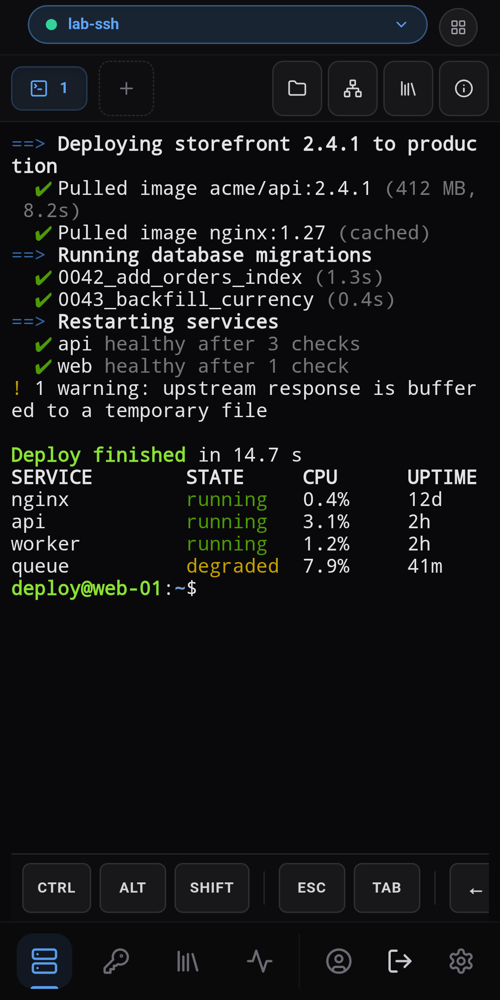
  &nbsp;&nbsp;
  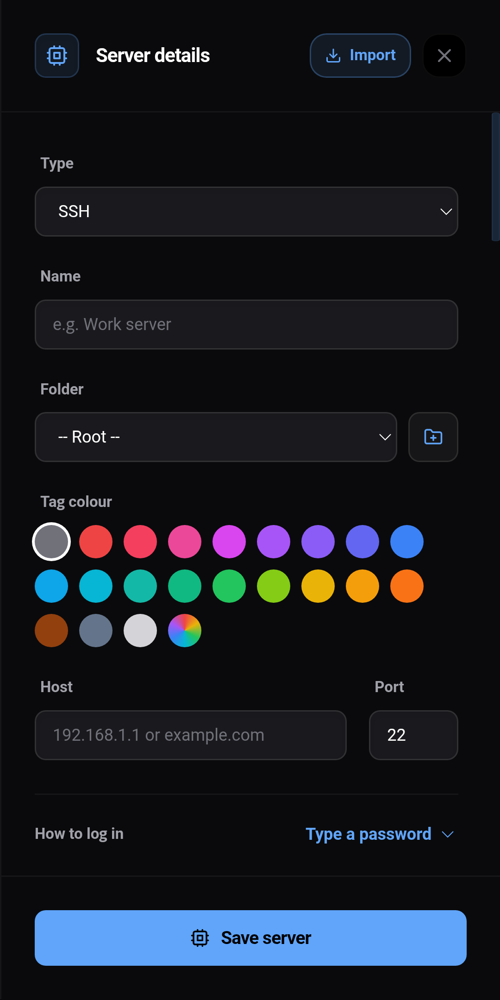
</p>

- **Same encrypted vault.** With cloud sync on, your profiles appear on the phone as they were on the desktop.
- **Touch-friendly terminal.** An inline **key bar** between the terminal and the keyboard has Esc, Tab, arrows, `|`, `~`, `/`, `-` and Termux-style sticky modifiers (tap to arm, double-tap to lock), so Ctrl+letter, Alt+letter and Shift+Tab work.
- **Auto-scroll on focus** so the prompt never sits behind the keyboard.
- **SFTP file browser** with multi-select, upload from the phone's storage and download into Downloads; exports go through the system file picker.
- **VNC and the built-in RDP client** show the remote screen with touch, zoom and a keyboard button, the connection mark and their speed and quality; a phone shares no files with an RDP server.
- **Fingerprint unlock** for a profile, if you turn it on; the app stays out of Recents.
- **Port forwarding** (SOCKS / local / remote) runs as long as the app is open.
- **Folder mirror is desktop-only for now.**

Built for Android 7.0 (API 24) and newer, on phones, tablets and Android-on-ChromeOS; the current builds are tested on Android 16.

## Security and privacy

**What is encrypted, and where**

1. **Your master password becomes a vault key on your device.** When you unlock, the password is run through Argon2id to derive a key, and the Rust backend keeps that key in zeroized memory and drops it on lock (the sharing key of a signed-in account is locked with the profile too). (The password you type passes through the webview, so a copy can linger in its memory until garbage collection.)
2. **Profiles are sealed with AES-256-GCM on your device.** Saved servers, credentials, keys, tunnels, notes, commands and mirrors are encrypted with that key; what reaches disk is ciphertext. Window position, the last-used profile name, recent folders and similar preferences are stored in the clear in the app's own settings.
3. **Quick unlock is opt-in.** If you turn on Windows Hello or an Android fingerprint, the vault key is sealed to a key in the TPM or the Android Keystore — never the password.
4. **Unencrypted protocols say so.** Telnet and plain VNC are labelled *not encrypted* in the form, the list and the tab. The built-in RDP client is labelled *experimental*.
5. **Connections are checked.** SSH host keys are pinned after the first use, and a changed key (or a key of a different kind) is flagged before anything secret is sent. An RDP certificate is pinned the same way, and the built-in RDP client refuses a server without NLA unless you allow that server.

**Cloud sync (optional) — what the server sees**

- Signing in uses an **email address** (verified by a link) and an **account password**, with reset by email. The master password itself is never sent.
- Each record is encrypted on your device before upload. The server **does see metadata**: record IDs, record types (servers, credentials, keys, notes, commands, folders), timestamps and deleted flags, the profile's display name, the number of records, and for shared profiles the share names and member email addresses.
- The server also holds a copy of the vault key **sealed with your master password**. Someone who got hold of the server's data could try to guess a weak master password offline, at Argon2id cost — so use a **long master password** if you sync. A server breach does not hand over the plaintext, but the master password is the only thing standing in the way.
- Cloud sync is **opt-in per account**: once you sign in, profiles you open are linked and synced (Auto-sync is on by default and can be turned off in Settings). Don't sign in on a computer if you don't want its profiles uploaded.
- You can run **your own sync server** instead of the hosted one.
- **You can delete your account from inside the app** (Cloud sync → *Delete account…*, confirmed with your password): everything the server holds for it goes at once. The full details, with retention times, are in the [privacy policy](PRIVACY.md).
- [How your data is protected](https://submarine.sinaxhpm.com/security/) explains all of this with links to the code that does it, and ways to check it yourself.

**Network traffic besides your servers**

- No analytics SDK, no crash reporter and no advertising calls.
- When the profile page opens, Submarine makes **one anonymous request to the GitHub releases API** to see whether a newer version exists (the request carries the app name and version, nothing else). There is a button to run the same check by hand.
- If you sign in to cloud sync, it talks to the sync server (`submarine.sinaxhpm.com`, or the one you chose).

**Other defences:** a strict Content Security Policy, a minimal Tauri permission ACL, and no shell or filesystem plugin exposed to the UI. The Windows build is not code-signed (see [Install](#install)); the Android APK is signed, and the App Store builds are signed by Apple's process.

Found a vulnerability? Please don't post exploit details in public: open an issue that says only that you found one, and the maintainer will reply with a private way to send the details.

## Code signing policy

Windows installers will be signed. Free code signing provided by [SignPath.io](https://about.signpath.io/), certificate by [SignPath Foundation](https://signpath.org/).

Until the first signed release, the installers aren't signed, and [Install](#install) says how to open them.

**Team roles:**

- Committers and reviewers: [paulm981](https://github.com/paulm981)
- Approvers: [paulm981](https://github.com/paulm981)

Every release is built by GitHub Actions from this repository's `main` branch, and every change reaches `main` through a pull request whose checks have passed.

**Check a download.** Each release file carries a signed record of where it was built: this repository, its build workflow, and the commit. To check one, install the [GitHub CLI](https://cli.github.com/) and run:

```
gh attestation verify Submarine-windows-x64-setup.exe --repo paulm981/Submarine
```

It says which commit the file was built from, or fails if it wasn't built here. Releases made since late October 2026 carry the record; older ones don't.

**Privacy policy:** This program will not transfer any information to other networked systems unless specifically requested by the user or the person installing or operating it.

What Submarine connects to:

- the servers you connect to;
- the folder or git repository you sync profiles through, if you set one up;
- the original project's hosted sync, only if you turn it on.

On its own, it makes one call: when the profile screen opens, it asks GitHub's public API whether there's a newer release. That call carries the app's version, and nothing about you or your servers.

## FAQ

### Is Submarine free?

Yes. MIT-licensed. Use it personally, use it at work, fork it, redistribute it.

### Does it work offline?

Yes. Cloud sync is optional. All profiles, mirrors and tunnels live locally and are encrypted at rest.

### I use PuTTY, WinSCP or MobaXterm today. What changes?

PuTTY and WinSCP are two separate apps you alt-tab between; Submarine puts terminal, SFTP, tunnels and folder mirror in one tabbed window per server. Coming from MobaXterm, import your sessions with their folders, saved logins and jump hosts, and keep working the way you do, on Windows, macOS or Linux, with one encrypted profile that syncs between them.

### Does it support keys with passphrases and ssh-agent?

Yes. File-based keys and pasted keys (OpenSSH, PEM, PKCS#8 and SEC1 formats) with or without a passphrase, and keys from a running ssh-agent — Pageant, the Windows OpenSSH agent, `SSH_AUTH_SOCK` or the `IdentityAgent` in your config.

### Does it read my `~/.ssh/config`?

Yes, read-only, and you can switch it off per device. It follows Include, Host and Match (Match `exec` is never run), ProxyJump, ProxyCommand, IdentityFile, CertificateFile and IdentityAgent. Nothing from those files is synced.

### Can I use FTP or FTPS?

Yes, from version 0.5: an FTP server opens in a tab with the same file browser as SFTP, with FTPS (TLS) by default, directly, through an SSH server or through a proxy. Plain FTP is there if you pick it, and the app says it isn't encrypted.

### Can I use RDP, VNC and Telnet?

Yes. VNC shows the screen in the tab and shares the clipboard (plain text). RDP opens in your computer's RDP app by default, or in the tab with the experimental built-in client, which shares the clipboard and, on the PC, a folder or a drive. Both remote screens show how the connection is doing and let you trade picture quality for less data. Telnet opens in a terminal tab. All three can go through an SSH server, and Telnet and plain VNC are labelled as not encrypted.

### Can I sync profiles between Windows and macOS?

Yes. The encrypted vault is platform-portable. Turn on sync on one machine, sign in and unlock on another with the same master password.

### Why Rust and Tauri instead of Electron?

Smaller installers (7–13 MB on desktop versus ~100 MB for a typical Electron app), no Chromium bundled per app, and native window controls.

### Where are my profiles stored?

In an encrypted file under your OS app-data directory — or in the `submarine-data` folder when you run in [portable mode](#portable-mode-windows). Server details and secrets are encrypted; a few preferences (the last-used profile name, recent folders, window position) are stored in the clear.

### Something went wrong — how do I find out what?

**Settings › Help**, under **Troubleshooting**. Submarine keeps a log on your computer (`submarine.log` in its log folder, at most 4 MB): connection steps, errors, crashes, and when the window froze, for how long and which terminal was receiving the most output then. **Copy diagnostics** puts the build, the system and the end of the log on the clipboard with server, folder and user names, host names and addresses replaced by placeholders, ready to paste to whoever is helping. **Open log folder** shows the files themselves.

### Does Submarine collect telemetry or analytics?

No. There's no analytics SDK, and no crash reporter that sends data home. The log under Troubleshooting stays on your computer unless you copy it yourself. Beyond your servers and the sync storage you set up, the app makes one call by itself: a check on GitHub for a newer release (see [Code signing policy](#code-signing-policy)). The original project's hosted sync is off unless you turn it on, and it only ever receives opaque ciphertext.

### Can I use Submarine on my Android phone with the same servers as my desktop?

Yes. Install the APK, turn on cloud sync, and unlock with the same master password — every server, key and saved tunnel appears on the phone. Folder mirror is desktop-only for now; terminal, SFTP, port forwarding, VNC and RDP work on Android.

### Is there an iPhone or iPad app?

The same source builds for iPhone and iPad (iOS and iPadOS 15 or later). The beta is on [TestFlight](https://testflight.apple.com/join/TmefAPrY), and the App Store version is with Apple's review. It works like the Android app: terminal, SFTP, port forwarding, VNC and the built-in RDP client, the same vault and sync. Exports land in the app's folder in the Files app; there are no folder mirrors, and no files are shared with an RDP server.

### Is Submarine on the Play Store?

No. It is distributed as a sideloadable APK from the [releases page](https://github.com/sinaxhpm/submarine/releases).

## Build from Source

Requirements: Node 20+, Rust 1.90+, [Tauri prerequisites](https://v2.tauri.app/start/prerequisites/) for your OS. The SSH stack is pure Rust, so no OpenSSL or Perl is needed on any platform.

```bash
git clone https://github.com/paulm981/Submarine
cd Submarine
npm install
npm run tauri dev          # run in development
npm run tauri build        # build release bundle
```

### Builds on GitHub

[`.github/workflows/build.yml`](.github/workflows/build.yml) builds the installers on GitHub's Windows, macOS and Linux runners:

- **Every merge into `main`** is a [release](https://github.com/paulm981/Submarine/releases), tagged with the original project's version and the fork's count: `v0.4.0-fork.1`, `v0.4.0-fork.2` and so on, starting again at 1 when the original project's version changes. The count is one more than the newest tag of that version. If the Windows build fails, no release is made, and the next merge makes it. The workflow passes the version to `src-tauri/build.rs`, which stamps it into the app.
- **Run workflow** on the [Actions tab](https://github.com/paulm981/Submarine/actions/workflows/build.yml) builds a version you type in, as a test, and publishes nothing.

Each run's files are also kept for 90 days under **Artifacts** on the run's page (GitHub sign-in needed there). Android is built only when the repository variable `BUILD_ANDROID` is `true` and the signing secrets the workflow names are set.

A release is Windows and Linux when it's made. A macOS minute uses ten of the account's GitHub Actions minutes, so the Mac build is added only to a release that has been tried: **Run workflow** with **Or: add the Mac build to this release** set to its tag, such as `v0.4.0-fork.19`. It builds the Mac app from that release's own code and adds the `.dmg` and the `.app.zip` to its downloads and its notes. Only a release that has its Windows installer gets one. The Mac app is for Apple silicon (M1 or later); it doesn't run on an Intel Mac. Pull request checks run on Linux and Windows, and on macOS too when the pull request has the `macos` label.

**Building macOS on your own Mac:** install the [Tauri prerequisites](https://v2.tauri.app/start/prerequisites/) (Xcode's command line tools, Rust, Node 20+), then in a clone of the repository run `npm ci` and `SUBMARINE_VERSION=0.4.0-fork.N npm run tauri build -- --bundles app,dmg` with the release's number. The app and the `.dmg` land in `src-tauri/target/release/bundle/`.

### Android build

Extra requirements: Android SDK + Platform-Tools, NDK 27, and JDK 17. `scripts/android-env.ps1` sets `JAVA_HOME`, `ANDROID_HOME`, and `NDK_HOME` for the current PowerShell session. It finds the SDK through `ANDROID_HOME` or `ANDROID_SDK_ROOT`, or in Android Studio's default folder (`%LOCALAPPDATA%\Android\Sdk`).

```powershell
. .\scripts\android-env.ps1
npm run android:init       # one-time per checkout
npm run android:dev        # build + install on the connected device
npm run android:build      # produce an APK (unsigned unless you configure a release keystore)
```

Device must be plugged in over USB with debugging enabled.

`npm run android:dev` runs `scripts/android-dev.ps1`, which:

1. Verifies `adb` is on PATH and at least one device is listed.
2. Applies `adb reverse tcp:1420 tcp:1420` and `tcp:1421 tcp:1421` (Vite dev + HMR) so the WebView reaches the host via USB loopback.
3. Runs `tauri android dev --host 127.0.0.1` so the WebView's `devUrl` bakes in `127.0.0.1`, matching what `adb reverse` exposes.

This path works whether Wi-Fi is on or off — only USB matters. If you still see `failed request for http://127.0.0.1:1420` while debugging, USB has dropped or the reverse mapping was cleared (re-plug, reboot, or `adb kill-server` all clear it). Re-run `npm run android:dev` and it'll re-apply the mapping. To bypass the helper, use `npm run android:dev:raw` (calls `tauri android dev` directly — Tauri then picks the host's LAN IP).

## Tech Stack

**Frontend** — React 18 · TypeScript · Tailwind CSS · xterm.js
**Backend** — Rust · Tauri 2 · russh · IronRDP · vnc-rs · rusqlite · aes-gcm · argon2 · zstd

## Credits

Designed and built by [Sina](https://sinaxhpm.com) in collaboration with [Claude](https://claude.com/claude-code). Every line of code in this repo was written together with Anthropic's Claude.

## License

MIT — see [LICENSE](LICENSE).

The app ships with the licences of everything in it: every build lists the JavaScript packages and Rust crates it includes, with their licence texts (`scripts/notices.mjs`), and the fonts' and color schemes' licences are in `public/licenses/`. In the app: Settings › Help, under Open-source licenses.

## Also by the author: Echoes — network & developer toolkit

<a href="https://github.com/SinaXhpm/Echoes"></a>

**[Echoes](https://github.com/SinaXhpm/Echoes)** is a [free, open-source network toolkit for Windows, macOS, Linux and Android](https://github.com/SinaXhpm/Echoes) with **20 network and developer tools in one app**: the things you would run one by one (ping, traceroute, nmap, curl, dig, whois, PuTTY, netcat, a speed-test site, the Cloudflare dashboard) behind one simple window. No account, no ads, no telemetry. MIT licensed.

<br clear="left" />

- **Diagnose** — a **connection doctor** that says in one sentence why a site won't open (DNS tampering, SNI filtering, a blocked IP, a filter page, or down for everyone), **ping, TCP ping, traceroute and MTR** (loss per hop, no admin rights needed), an **internet speed test** with a bufferbloat grade, a **TCP/UDP port scanner** with service and version detection (an nmap alternative), **check host** from servers around the world, and **network info** with a Wi-Fi analyzer, ARP neighbours, open ports and the routing table
- **DNS and web** — **DNS lookup** over UDP, DNS over HTTPS and DNS over TLS with resolver comparison and an email (SPF, DKIM, DMARC) check, **WHOIS / RDAP**, a **cURL / HTTP client** that imports curl commands (a Postman alternative), an **SSL/TLS certificate inspector**, **IP and GeoIP lookup**, a **Cloudflare manager** with dynamic DNS, and a **Telegram Bot API tester**
- **Servers and connections** — an **SSH client** (terminal, SFTP, port forwarding, server health), a **TCP / UDP / WebSocket tool** (a netcat alternative), **LAN file sharing and chat** in any browser with a QR code plus a webhook catcher, a **SOCKS5 + HTTP proxy server** with a **proxy checker**, and an **uptime monitor** with Telegram alerts and certificate and domain expiry warnings
- **Workspace** — **String Lab** (Base64, hashes, JWT, JSON ↔ YAML / CSV, regex, subnet / CIDR calculator, cron, UUID and password generators), **encrypted notes**, and **history with one encrypted backup file**
- **Built with** C# · .NET · Avalonia UI · Native AOT — self-contained native apps for Windows, macOS (Intel and Apple Silicon), Linux and Android 6.0+, with nothing extra to install, dark and light themes, and secrets encrypted on your device

[Echoes on GitHub](https://github.com/SinaXhpm/Echoes) · [Download Echoes for Windows, macOS, Linux and Android](https://github.com/SinaXhpm/Echoes/releases) · [More projects by Sina Xhpm](https://sinaxhpm.com)

---

<sub>
<b>Keywords</b>: SSH client, SFTP client, FTP client, FTPS client, FileZilla alternative, Telnet client, VNC viewer, RDP client, remote desktop client, terminal emulator, port forwarding, SSH tunnel manager, SOCKS proxy, HTTP proxy, jump host, ProxyJump, ssh-agent, Pageant, SSH certificates, Teleport, folder mirror, folder sync, remote file edit, encrypted profile sync, self-hosted sync, Windows Hello unlock, Argon2id, AES-256-GCM, TOFU host keys, Rust, Tauri, React, xterm.js, Windows SSH client, macOS SSH client, Linux SSH client, Android SSH client, open source SSH, MIT licensed, PuTTY alternative, WinSCP alternative, MobaXterm alternative, Bitvise alternative, Termius alternative, SecureCRT alternative, Royal TSX alternative, Remmina alternative, ConnectBot alternative, JuiceSSH alternative, rsync GUI, sshfs alternative, Tabby alternative.
<br/>
<b>Echoes</b>: network toolkit, network tools, connection doctor, website not loading, DNS tampering test, SNI filtering test, ping, TCP ping, traceroute, MTR, WinMTR alternative, internet speed test, bufferbloat test, port scanner, nmap alternative, check host, Wi-Fi analyzer, DNS over HTTPS, DNS over TLS, DNS benchmark, SPF DKIM DMARC checker, WHOIS, RDAP, cURL GUI, Postman alternative, SSL checker, TLS inspector, IP lookup, GeoIP, Cloudflare manager, Cloudflare DDNS, dynamic DNS client, uptime monitor, Telegram alerts, netcat alternative, WebSocket client, webhook tester, LAN file sharing, QR code file transfer, SOCKS5 proxy server, proxy checker, JWT decoder, CyberChef alternative, encrypted notes.
</sub>

<sub><i>Bitvise, forever in my heart.</i></sub>
